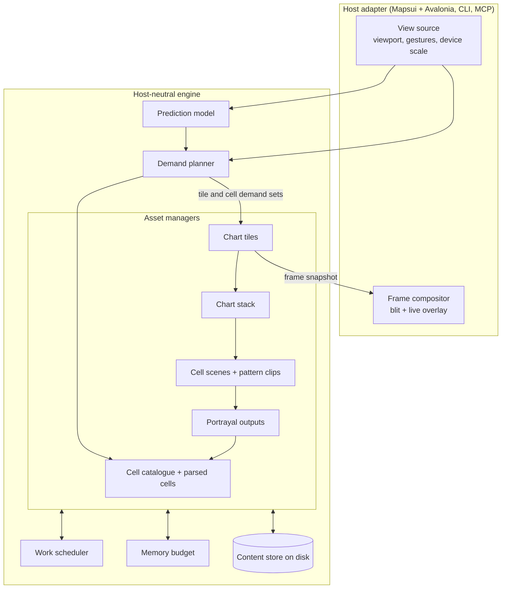
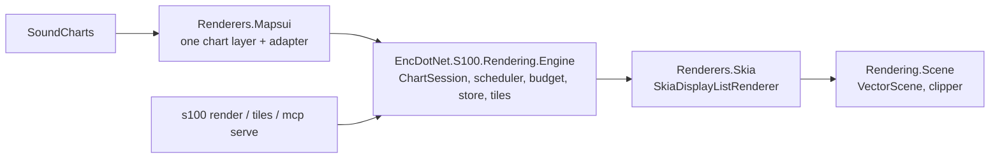

# Map rendering architecture

This note designs how SoundCharts and the `s100` tool turn chart cells into
pixels. It starts from a clean slate, then maps the design onto the code on
`main` and lays out a staged migration. It is a proposal. Nothing here is
built yet.

It replaces the scheduling, caching and layer model in
[S-100 render subsystem design](S100-Render-Subsystem-Design.md). It keeps that
note's tile grid, scene IR, planes and most of its hard-won rules. That note's
appendices remain the record of why those rules exist.

Each choice is tagged:

- **[M]**: a measured number from the perf rounds drives it.
- **[H]**: a hypothesis. The slice that ships it must measure it first.
- **[F]**: a fact read from the code, not a measurement.

## The problem

A user jumps to a new place in a 298-cell NOAA collection. Today:

- A cold jump settles in 5–18 s. After the background pre-warm it settles in
  1.2–1.8 s, with loads arriving in waves about 300 ms apart. [M]
- Lua portrayal takes 0.2–7 s per cell. Parsing takes 10–500 ms. [M]
- Cold loads allocate about 2 GB/s. 73% of allocations come from MoonSharp and
  18% from NTS `CascadedPolygonUnion` in pattern clipping. [M]
- A spike for [#1278](https://github.com/philliphoff/EncDotNet.S100/issues/1278)
  ran the same S-101 rules on Lua-CSharp 0.5.8. Output was byte-identical, with
  about 9× fewer bytes allocated and `PortrayalMain` 2.3–2.8× faster. US3WA1EF
  went from 3.7 s and 5,027 MB to 1.3 s and 553 MB. [M]
- With workstation GC about 3 of 16 cores were busy. Server GC cut pauses from
  13.5 s to 1.1 s but holds 3–5 GB committed. [M]
- Peak working set is 7–10 GB with about 40 cells loaded: about 5.5 GB GC heap
  and 3.5 GB native tile bitmaps. [M]
- Layers of a tile slot reveal one at a time. [M, Appendix J of the old note]

Five structural causes sit under these numbers. They're read from the code.

1. **Nothing schedules across stages.** Loads, portrayal, pre-warm, tile
   raster, pattern clip and validation each have their own concurrency limit:
   `MaxConcurrency = max(2, cores/2)` for lazy loads, `MaxSpeculativeConcurrency
   = 1`, one pre-warm worker, `MaxRefreshConcurrency = max(2, cores/2)` for bulk
   refresh, per-layer tile worker floors, and `Task.Run` for validation. No
   component can say "this visible tile matters more than that pre-warm cell". [F]
2. **The unit of rendering is the Mapsui layer.** Each cell has two layers
   (areas, line work). Each layer has its own `TileState`, its own pending sets,
   its own workers, its own 256 MB tile cache and its own GPU cache. Memory and
   worker count scale with cells × layers, not with the screen. [F]
3. **One cell is one serial Lua run, on an interpreter that allocates for every
   value.** `PortrayalMain` runs every feature of a cell in one MoonSharp
   `Script` on one thread. Every Lua value is a heap `DynValue`, and every call
   allocates a `CallStackItem`. A 7 s cell holds one core for 7 s while the
   visible view waits for it, and its garbage stalls the other cores. [F]
4. **The UI thread composes.** `ComposeLayers` (stack projection, S-98 rules,
   overlap suppression with O(n²) NTS `Intersects`, layer diff) runs on the UI
   thread after every cell load: about 230 ms per 14-cell load. [M]
5. **Two compositors.** The viewer uses `S100VectorTileRenderer`. The CLI and
   headless MCP use `HeadlessCompositor` and `HeadlessTileRenderer`, which
   handle coverage overlap with bounding boxes instead of NTS. [F]

## Goals and constraints

- The visible view always comes first.
- Keep every core busy whenever there is useful work, without delaying
  visible work by more than one short job.
- Do work on demand. Do speculative work only when it can't delay visible
  work, and release it early when it's no longer likely to be needed.
- The core depends on no host. Mapsui and Avalonia sit behind an adapter.
  The CLI and MCP hosts use the same core.
- Packages are in preview, so breaking API changes are fine.
- Never copy GPL code, for example from OpenCPN.

## Design principles

1. **Everything expensive is a content-addressed asset.** A parsed cell, a
   portrayal output, a cell scene, a pattern clip and a raster tile each have a
   key that hashes their inputs. The same key always means the same bytes. This
   is what makes caching, single-flight and disk reuse safe.
2. **Demand flows down; assets flow up.** The view says which tiles it needs
   and how urgently. Each asset asks for its own inputs with the priority it
   inherited. Nothing upstream guesses what the view wants.
3. **One scheduler, short jobs.** Every stage runs on one pool of worker
   threads, through one priority queue. Long work is split into jobs short
   enough that a newly visible job never waits long for a core.
4. **Hosts only blit.** The UI and render threads read immutable snapshots and
   draw. They never parse, portray, compose, clip or rasterise.
5. **The screen, not the cell count, bounds memory.** One global budget covers
   managed and native memory. Raster tiles are composited across cells, so
   their count depends on the viewport, not on how many cells are loaded.

## Components



### Chart session

`ChartSession` is the engine's root object. A host creates one per map. It owns
the cell catalogue, the asset managers, the demand planner and the chart stack.
It takes a scheduler, a memory budget and a content store, which a process can
share across sessions. The CLI `tiles` command and the viewer construct it the
same way.

```csharp
public sealed class ChartSession : IAsyncDisposable
{
    public ChartSession(ChartSessionOptions options, IWorkScheduler scheduler,
        IMemoryBudget budget, IContentStore store);

    public ICellCatalogue Cells { get; }            // sources, bounds, coverage
    public ChartSettings Settings { get; set; }      // mariner, palette, display
    public ChartStackSnapshot Stack { get; }         // latest published stack

    // The host reports what it shows. Cheap; never blocks.
    public void SetView(ViewState view);

    // Latest frame snapshot for a host to draw. Never blocks, never allocates
    // per call beyond the returned struct.
    public FrameSnapshot GetFrame(ViewState view);

    // Headless hosts await a complete result instead.
    public ValueTask<ChartImage> RenderAsync(ViewState view, RenderQuality q,
        CancellationToken ct);
    public IAsyncEnumerable<ChartTile> RenderTilesAsync(TileRequest request,
        CancellationToken ct);

    public event Action<FrameChanged>? FrameChanged;  // raised off-thread
}

public readonly record struct ViewState(
    double CenterX, double CenterY,     // EPSG:3857 metres
    double Resolution,                  // metres per device-independent pixel
    double Rotation,
    int WidthDip, int HeightDip,
    float DeviceScale,
    long TimestampTicks,
    ViewMotion Motion);                 // idle, pan, fling (with target), animated (with target)
```

`ViewState` is the only thing a host must supply. `ViewMotion` carries the
destination when the host knows it: a fling's resting viewport, or the target
of an animated `CenterOnAndZoomTo`. [H: the Mapsui `Navigator` exposes enough to
fill this in; see the open questions.]

### Work scheduler

One scheduler serves every stage: parse, translate, portray, build scene,
clip, compose stack, rasterise, encode, write to disk and validate.

```csharp
public enum WorkClass
{
    Visible = 0,     // needed for the current frame
    Predicted = 1,   // likely needed within the prediction horizon
    Background = 2,  // pre-warm, idle fill, cache writes
    Validation = 3,  // never competes with drawing
}

public readonly record struct WorkPriority(WorkClass Class, double Urgency);
// Lower Urgency runs first: seconds until needed, or distance from the view centre.

public enum WorkStage { Parse, Translate, Portray, Scene, Clip, Stack, Raster, Encode, Io, Validate }

public interface IWorkScheduler
{
    // Single-flight: a second Schedule with the same key joins the first job.
    WorkHandle<T> Schedule<T>(WorkKey key, WorkStage stage, WorkPriority priority,
        Func<WorkContext, ValueTask<T>> run);

    SchedulerStats Stats { get; }  // queue depth per class and stage, busy workers, GC pause share
}

public sealed class WorkHandle<T>
{
    public Task<T> Result { get; }
    // Interest is reference counted. Priority is the best priority of all
    // current holders. When the last holder goes, the job is cancelled.
    public WorkInterest AddInterest(WorkPriority priority);
}

public sealed class WorkContext
{
    public CancellationToken Cancelled { get; }  // no one wants the result
    public bool YieldRequested { get; }          // a better job is waiting for this core
    public WorkPriority Priority { get; }        // may rise while the job runs
    // Splits work into child jobs that inherit this job's priority and token.
    public WorkHandle<T> Spawn<T>(WorkKey key, WorkStage stage,
        Func<WorkContext, ValueTask<T>> run);
}
```

Rules:

- **Worker threads.** The scheduler owns `ProcessorCount − 1` dedicated threads
  in the viewer, leaving a core for the UI and render threads, and
  `ProcessorCount` in the CLI. It doesn't run jobs on the .NET thread pool, so
  pool starvation ([#820](https://github.com/philliphoff/EncDotNet.S100/issues/820),
  [#982](https://github.com/philliphoff/EncDotNet.S100/issues/982)) can't block
  it, and its own jobs can't starve async continuations. Disk reads go
  through async IO and don't hold a worker. [F: the starvation cases; H: that
  dedicated threads remove them]
- **Strict priority, then urgency.** A free worker takes the best job across
  all stages. There are no per-stage or per-layer quotas, and no worker floors.
  Visible work can use every worker.
- **Priority inheritance.** A visible tile that needs a scene that needs a
  portrayal raises the portrayal to `Visible`. A pre-warm portrayal that a jump
  suddenly needs is promoted while it runs and doesn't restart.
- **Short jobs.** The target is that no job holds a core for more than about
  100 ms. Long stages split into child jobs: Lua portrayal by feature shard,
  pattern clipping by pattern group, scene building by instruction range, and
  tile raster is already short. A visible job then waits at most one job length
  for a core. [H: 100 ms; measure the job-length distribution]
- **Cooperative yield.** Jobs that can't split cleanly poll `YieldRequested`
  and `Cancelled`. The Lua emit hook that #1266 added for cancellation already
  gives this a per-feature check point. [F]
- **Cancellation by interest.** A job is cancelled when its last interest is
  dropped. The demand planner drops interest when it publishes a new demand set
  that no longer contains the asset. No component holds a
  `CancellationTokenSource` per load any more.
- **Allocation-aware admission.** GC pauses stop every core, so the scheduler
  caps concurrent allocation-heavy jobs (`Portray`, `Clip`) in the `Background`
  class by observed GC pause share (`GC.GetTotalPauseDuration` over a sliding
  window), not by a fixed count. Visible work is never capped. [M: GC paused
  40–60% of wall clock under workstation GC; H: that a pause-share feedback loop
  keeps throughput up without the committed-memory growth in
  [#1276](https://github.com/philliphoff/EncDotNet.S100/issues/1276)]. After the
  Lua-CSharp switch this is a backstop rather than a main control: Lua
  allocates about 9× less, and NTS pattern clipping becomes the largest
  allocator. [M: 9×; H: the new allocation split, which step 0 measures]

### Asset managers

Each asset kind has a manager with the same shape. The sketch called for
"fetch", "likely needed" and "no longer needed" per asset. This design keeps
fetch and makes the hints declarative: a producer publishes a whole demand set,
and the manager diffs it against the previous one. A key that drops out of the
set is no longer needed. No one has to remember to call "unlikely" for each
key, so missed calls can't leak work or memory.

```csharp
public interface IAssetManager<TKey, TAsset> where TKey : notnull
{
    // Returns at once if resident. Otherwise schedules the work (or joins it).
    ValueTask<AssetLease<TAsset>> FetchAsync(TKey key, WorkPriority priority,
        CancellationToken ct);

    // Never schedules work. Used by the frame path.
    bool TryGet(TKey key, out AssetLease<TAsset> lease);

    // Replaces the demand this producer placed earlier. Keys not in the new
    // set lose this producer's interest; queued work for them is cancelled
    // and resident copies become eviction candidates at once.
    void SetDemand(DemandProducer producer, IReadOnlyList<Demand<TKey>> demand);

    // A strong signal, for example a cell the user has scrolled far away from.
    void Release(TKey key);
}

public readonly record struct Demand<TKey>(TKey Key, WorkPriority Priority,
    double Probability, TimeSpan TimeToNeed);

public readonly struct AssetLease<T> : IDisposable
{
    public T Value { get; }
    // Reference counted. Eviction never frees an asset while a lease is open.
}
```

Leases fix a class of bugs the old note records: use-after-free on zoom-out
(F.6) and worker raster into a dying Skia (F.10). Native objects are freed only
when the last lease closes, and GPU objects only on the render thread.

The asset kinds, their keys and their costs:

| Asset | Key (hash of) | Cost | Where it lives |
|---|---|---|---|
| Cell catalogue entry | catalogue record | none | always resident |
| Parsed cell | file bytes, updates, translator version | 10–500 ms [M] | memory |
| Portrayal output | today's portrayal content hash + rule key | 0.2–7 s [M] | memory, disk (`.dlist`) |
| Cell scene | portrayal key, display filter, palette, symbol and text scale | unmeasured [H] | memory, disk (new) |
| Pattern clip | today's clip key | 18% of cold allocations [M] | memory, disk (`.clip`) |
| Chart stack | ordered loaded cells, S-98 rules, settings | about 230 ms per 14 cells today [M] | memory |
| Chart tile | tile slot, ordered scene keys that touch it, pixel size | unmeasured per tile [H] | memory, GPU, disk |

The portrayal key already exists and is sound: it hashes the dataset bytes, the
feature and portrayal catalogues, assembly versions and the mariner settings
that change Lua output. Display toggles re-filter that output without re-running
Lua ([#1149](https://github.com/philliphoff/EncDotNet.S100/issues/1149)). The
cell scene key keeps that rule: it hashes the filter, not the Lua inputs. [F]

### Chart tiles: one raster per slot, across all cells

This is the largest change. Today a tile slot on screen is the sum of one tile
per loaded layer that touches it, each from its own cache. In this design a
slot has one **chart tile**. It holds the base plane of every cell that touches
the slot, drawn in stack order, with finer-cell coverage clipping applied while
rasterising.

```csharp
public readonly record struct ChartTileKey(
    int Band, int X, int Y, int ScaleClass,
    int PixelSize,          // device scale is part of the key [M: 1x MCP captures polluted retina caches]
    Hash128 StackSlice);    // hash of the ordered scene keys and clip inputs for this slot only
```

What this buys:

- **Atomic reveal.** A slot changes from one complete image to another. Layers
  and cells can't flash in one at a time. `TileRevealGroup` and its 400 ms hold
  go away. [F: per-dataset groups today can't hold across cells]
- **Stale-while-revalidate.** When a cell lands, only slots whose
  `StackSlice` changes get new keys. Their old images stay on screen until the
  new ones are ready, then swap. This generalises today's predecessor stand-in
  (`TryBindFilteredScene`, `PredecessorLifetime`).
- **Memory bounded by the screen.** Resident tiles ≈ visible + predicted slots
  × a few bands, whatever the cell count. [M: 3.5 GB native today, with 80
  per-layer caches of up to 256 MB]
- **Fewer blits and uploads.** One `DrawImage` per slot instead of one per
  layer per slot. [M: warm pan frames are gated by `BlitTile` and
  `ToTextureImage`, not CPU]
- **Hidden coarse tiles cost nothing.** A coarse cell whose part of a slot one
  finer coverage hides contributes no ops to that slot's raster. The
  rule stays "one finer coverage hides it", not a union, to avoid hairlines at
  the seams. [M]
- **Content-addressed disk reuse.** The key depends only on what's in the slot,
  so a slot cached in one session is valid in the next whenever its cells and
  settings match. The CLI `tiles` command can share the store.

What it costs:

- **Re-raster on change.** A landing cell re-rasterises every slot it touches,
  including the other cells' ops there. Loads that land within one stack
  version (below) are batched into one re-raster. [H: the per-slot raster cost
  with 5–10 overlapping cells is small enough. Measure it first; see the risks.]
- **More scale classes.** A slot's `ScaleClass` thresholds are the union of its
  cells' SCAMIN values inside the band's √2 window. [H: the class count per
  slot stays small]

Raster tiles are still drawn with a gutter so lines stay continuous across
seams. But the stored image holds only the core plus a 2-pixel apron for
bilinear sampling. Today the stored image includes the full 64 DIP gutter on
each side: `(256 + 128)² / 256² = 2.25×` the core's pixels. Storing core plus
apron needs `(260/256)² ≈ 1.03×`. That cuts tile memory by about 54% before any
other change. [F: `TilePixelSize` and `BlitTile` clip to the core; H: nothing
else reads the stored gutter]

The planes from the old note stay:

| Plane | Contents | Drawn |
|---|---|---|
| Base | areas, patterns, lines | chart tiles, off-thread |
| Overlay | point symbols, soundings | live per frame, from a merged overlay index across cells |
| Label | free text, decluttered | live per frame |
| Coverage | S-102 and other gridded products | chart tiles, in stack order [H: phase 2] |
| Dynamic | AIS, own ship, route, pick | live per frame, unchanged |

The overlay and label planes stay live because point symbols must hold a
constant screen size (F.11). They draw a cell's symbols only once its base
plane shows in that slot.

### Chart stack

The chart stack is the ordered list of cell scenes for the session, with the
S-98 interoperability result and the finer-coverage relations. It's an
immutable snapshot with a version number.

- It's built as a `Stack`-stage job, never on the UI thread.
- It's incremental. A new cell computes its relations to the cells it overlaps,
  found through an R-tree of coverage envelopes: O(k) NTS tests, not the
  O(n²) `CollectFinerCoverages` loop. [F: O(n²) today; M: 230 ms per 14 cells]
- **Stack versions batch arrivals.** Cells that finish within a short window
  (start at 50 ms) go into one version. Each version triggers one round of
  slot re-rasters. This turns today's 300 ms load waves into fewer, larger
  reveals. [M: waves about 300 ms apart; H: the window]
- S-98 feature suppression (for example R-101-102-B, S-101 depth areas under
  S-102) becomes a filter on the scene's ops in the stack, not a filtered copy
  of a Mapsui layer.

### Demand planner and prediction

The demand planner turns a `ViewState` and a prediction into demand sets for
two asset kinds. Everything else follows by inheritance.

- **Tile demand** covers what draws within about a second: the visible slots,
  a halo, a fan along the pan velocity, and ±1 band around the centre.
- **Cell demand** covers what portrays within a few seconds. Lua takes up to
  7 s per cell, so cell demand must look further ahead than tiles. [M]

```csharp
public interface IPredictionModel
{
    // Called on every ViewState. Returns weighted future views.
    IReadOnlyList<PredictedView> Predict(ViewHistory history, PredictionInputs inputs);
}

public readonly record struct PredictedView(ViewState View, double Probability, TimeSpan Horizon);

public sealed record PredictionInputs(
    RouteLegs? ActiveRoute,     // legs ahead of own ship
    OwnShipState? OwnShip,      // in follow mode
    IReadOnlyList<GeoPoint> RecentPlaces);
```

Model, by strength of signal:

1. **Known destinations.** A fling's resting viewport and an animated zoom's
   target are known when the gesture starts. These get probability near 1 and
   `Predicted` class. [H: the strongest predictor; today only an EMA of the
   centre delta is used]
2. **Motion.** EMA of centre velocity (today's `VelocityEstimator`, α = 0.4)
   plus a zoom-rate estimate (new). The fan depth scales with speed, as now.
   [F]
3. **Route and own ship.** In follow mode, cells along the next few legs of the
   active route get `Predicted` cell demand, nearest first.
4. **History.** Recent places and the start view get low-probability cell
   demand, so jumping back is warm.
5. **Idle.** When the view is idle, `Background` cell demand covers the whole
   collection, nearest first: today's pre-warm.

Release hints come from the same model. A cell behind the direction of travel,
outside the ahead window and not in recent history drops out of cell demand.
Its scene and tiles become first in line for eviction. Parsed cells and
portrayal outputs stay on disk, so a cell that comes back costs a warm load,
not a cold one.

Today's covered-cell deferral
([#1265](https://github.com/philliphoff/EncDotNet.S100/issues/1265)) stays
inside the planner: a coarse cell whose part of the view finer cells cover gets
`Predicted` rather than `Visible` demand. It still uses catalogue coverage
polygons, because bounding boxes are unsafe along coastlines. [M]

The planner measures itself. Each visible slot that was already resident when
it became visible counts as a prediction hit. Each prediction that expired
unused counts as waste. Today's `PredictedInCache` counter becomes this metric.

### Memory budget

One budget covers every asset manager and both kinds of memory.

```csharp
public interface IMemoryBudget
{
    long LimitBytes { get; }
    MemoryAccount Open(string name, MemoryKind kind);  // Managed or Native
    MemorySnapshot Snapshot();  // per account, GC committed, GC heap, native
}

public sealed class MemoryAccount
{
    public void Charge(long bytes);   // exact for native (bitmaps), estimated for managed
    public void Credit(long bytes);
}
```

- **Limit.** A share of physical memory, by machine tier. Proposed: 25% of RAM,
  capped at 6 GB in the viewer. [H]
- **Native memory is exact.** Raster bytes are `w × h × 4`. GPU textures have
  their own account, sized from the Skia resource budget that is already tiered
  by machine. [M: the default of about 28 MB thrashed]
- **Managed memory is estimated.** Each asset reports an estimate when it's
  built (op counts × typical sizes, feature counts for parsed cells). The
  budget checks the sum against `GC.GetGCMemoryInfo().HeapSizeBytes` and
  scales estimates to match. [H: estimates track the real heap within 30%]
- **Eviction ranks by value.** Score = demand class and probability, then
  time since last use, then rebuild cost per byte. Assets with no demand go
  first. A leased asset is never evicted.
- **A parsed cell is the cheapest to drop and the costliest to keep.** It's
  only needed to build a scene and to answer picks. Once the scene exists, the
  parsed cell can go. A pick re-parses on demand at `Visible` priority. [H:
  10–500 ms pick latency on a cold pick is acceptable; or keep parsed cells for
  visible cells only]
- **Give memory back after bursts.** When the scheduler has been idle for a
  few seconds after heavy work, the budget runs one compacting, decommitting
  gen-2 collection, rate-limited and never during a gesture
  ([#1276](https://github.com/philliphoff/EncDotNet.S100/issues/1276) item 1).
- **Report it.** `MemorySnapshot` feeds `get_render_stats` with the managed,
  native and GC-committed split
  ([#1276](https://github.com/philliphoff/EncDotNet.S100/issues/1276) item 3).

### Content store

One content-addressed disk store serves every asset kind.

- A file per key under a kind folder. Writes go through a temp file and an
  atomic move, as today.
- One global byte budget with per-kind shares. A running size index replaces
  directory scans on each write
  ([#691](https://github.com/philliphoff/EncDotNet.S100/issues/691) item 4).
- Writes are background jobs. Reads are async IO and hold no worker.
- **Tile codec.** PNG at level 100 is slow to encode. Use a fast lossless
  format for the cache (LZ4 or zstd over premultiplied pixels) and keep PNG for
  exports. [H: measure encode and decode per tile against PNG]
- **Empty slots are recorded.** A slot with no ops gets a zero-byte marker so
  nothing rasterises or decodes it. The spatial-index filter that removed the
  63% of empty PNGs stays as the first check. [M]
- **New: cell scenes on disk.** A warm load today still parses the cell and
  rebuilds its scene from cached Lua output. Storing the scene (ops and index)
  lets a warm slot render without parsing at all. [M: done after slice 11; a
  second session settles 23% sooner]

### Threading model

| Thread | May do | Must not do |
|---|---|---|
| UI | input, `SetView`, settings, read snapshots | parse, portray, compose, NTS, raster, disk IO |
| Render (Mapsui draw callback) | `GetFrame`, blit chart tiles, draw live planes, GPU upload within a per-frame budget, free GPU objects | wait on a lock held by workers, schedule work synchronously |
| Workers (`ProcessorCount − 1`) | every scheduled job | touch a `GRContext` |
| Async IO | disk reads and writes | CPU-heavy work |

- **Snapshots.** Workers publish immutable results by atomic reference swap:
  `ChartStackSnapshot`, the tile index for the current view, overlay indices.
  The render thread reads them without locks.
- **GPU upload.** CPU-raster workers produce `SKImage`s. The render thread
  uploads them with `ToTextureImage` up to a per-frame byte budget, visible
  slots first. A slot swaps to its new image only once it's uploaded, so an
  upload never shows a half-ready slot. Once uploaded, the CPU copy is released;
  the disk store can restore it. [M: pans are gated by upload; H: the
  per-frame budget smooths it]
- **No `SynchronizationContext` assumptions.** Viewport callbacks call
  `SetView`, which is thread-safe. Anything that must run on the UI thread goes
  through an injected dispatcher
  ([#1138](https://github.com/philliphoff/EncDotNet.S100/issues/1138)).

### Keeping every core busy without starving the view

1. Every stage is in one queue, so an idle core always finds the best work
   available, whatever stage it's in.
2. Splitting long jobs bounds how long a visible job waits: at most one job
   length, about 100 ms. [H]
3. **Lua runs in shards.** S-100 Part 9a defines `PortrayalMain(featureIDs)`,
   and `LuaPortrayalSession` already calls it with a feature subset. A cell's
   features split into shards of about 500 features. Each shard runs in its own
   Lua state on its own worker, and the outputs merge in feature order before
   the existing de-duplication and priority sort. On Lua-CSharp the slowest
   measured cell takes 1.3 s on one core, so shards could bring it to a few
   hundred milliseconds. [F: the entry point takes IDs; M: 1.3 s; H: the
   speed-up, and that shard outputs match a full run byte for byte]
   - `TextPlacement` features must go in the same shard as the feature they
     belong to, because `PortrayalMain` handles them after their parent.
   - Each shard pays the Lua state set-up cost. Pool and reuse prepared states
     per catalogue and context. [H: set-up is a small share; measure on
     Lua-CSharp, not MoonSharp]
   - Every shard runs with the same engine shims as a full run (the `__eq` and
     `require` fixes from [#1278](https://github.com/philliphoff/EncDotNet.S100/issues/1278)), so shard parity and engine parity are tested
     together.
4. Pattern clips split by `(PatternReference, priority)` group, which
   `ClipPatternAreas` already forms. [F]
5. **Pre-warm uses idle cores.** When nothing visible or predicted is queued,
   `Background` portrayal fills every free worker, limited only by the GC
   pause feedback. Today one worker takes 63 s for 298 cells. [M: 63 s; H: 15
   workers bring that under 10 s]
6. Validation runs in the lowest class and never delays a tile.

### Hosts



- **Engine.** A new host-neutral project. It depends on `Rendering.Scene`,
  `Renderers.Skia`, the dataset pipelines and NTS, but not on Mapsui or
  Avalonia. Skia is a raster library here, not a host.
- **Mapsui adapter.** One custom layer, `ChartLayer`, draws the base, overlay
  and label planes for the whole session. Mapsui no longer gets one layer per
  cell, so `ReplaceDatasetLayers` no longer walks hundreds of layers. Its
  renderer delegate calls `session.GetFrame(view)` and blits. Picks go through
  the engine's spatial index (`IdentifyFeaturesService` already works this way),
  not through one Mapsui `IFeature` per op.
- **Avalonia.** Provides the dispatcher, device scale and the `GRContext` on
  the render thread. Nothing else.
- **`s100 tiles`.** Creates a `ChartSession` with prediction off, a large
  memory limit, all cores, and the shared content store. It calls
  `RenderTilesAsync` over the requested range. Tile jobs run in the `Visible`
  class in the order they will be written. MBTiles, PMTiles and XYZ sinks stay
  as they are.
- **`s100 render`.** Calls `RenderAsync` for one view. The engine renders the
  view's slots and stitches them, or rasterises the view as one tile when that
  is cheaper. Portrayal of several cells runs in parallel, which `render`
  doesn't do today. [F]
- **`s100 mcp serve`.** Same as `render`, with a resident session. Captures
  honour `pixelDensity` through `DeviceScale`, which the headless path ignores
  today. [F]
- **SoundCharts MCP captures.** Call `RenderAsync` at the requested size and
  density instead of re-running Mapsui's renderer into a bitmap. A capture's
  tiles go in a different pixel-size key from the screen's tiles.

The engine replaces `HeadlessCompositor`, `HeadlessTileRenderer` and the tile
half of `S100VectorTileRenderer`. The CLI and the viewer then share one coverage
model (NTS), one scale-class rule and one disk format.

### Rules that must stay solved

| Earlier problem | Where the rule lives in this design |
|---|---|
| 63% empty disk tiles | spatial-index content check before scheduling, plus empty markers in the store |
| GPU upload thrash | Skia resource budget tiered by machine, plus a per-frame upload budget |
| Clip paths for every finer cell | stack relations found through an envelope R-tree; tile raster clips only by coverages that touch the slot |
| Overscale curtain rebuild | regions memoised per stack version; only the overscale filter runs per zoom step |
| Hidden coarse tiles | skipped only when one finer coverage hides them, never by a union |
| Device scale in tile keys | `PixelSize` in `ChartTileKey` |
| Snapped band up to √2 off the live scale | `ScaleClass` and `ScaleMinimumCap` unchanged, per slot |
| World copies at −C, 0, +C | unchanged in the tile grid; seam and gutter rules move with `RasterizeTile` |
| `SynchronizationContext` in viewport handlers | `SetView` is thread-safe; injected dispatcher |
| `ReplaceDatasetLayers` O(L²) | one chart layer; the diff stays for the other bands |
| Display toggles re-run Lua | cell scene key hashes the filter, not the Lua inputs |
| Pan frames gated by upload | one blit per slot, per-frame upload budget |
| UI-thread compose | `Stack` jobs on workers |

## How the existing code fits

### Component map

Keep: moves unchanged or nearly. Reshape: same idea, new shape. Replace: new
code does the job. Delete: no longer needed.

| Today | Verdict | In this design |
|---|---|---|
| `TileGrid`, `TileRange`, `VisibleTileRange`, `PredictedTiles`, `CrossBandPrewarmTiles` | keep | engine tile grid and demand planner |
| `VelocityEstimator` | keep | prediction model, motion input |
| `TileKey` | reshape | `ChartTileKey`: add `PixelSize`, `StackSlice` |
| `TileScaleClass` | keep | thresholds become the union of a slot's scenes |
| `TileCache` (per layer) | replace | chart tile manager on the global budget |
| GPU `TileCache` and `GpuRegistry` | reshape | render-thread GPU account; one cache, not one per layer |
| `TileDiskCache` | reshape | content store, tile kind; running size index; faster codec |
| `DiskPortrayalInstructionCache` | keep | content store, portrayal kind; add single-flight |
| `DiskPatternClipCache`, `InMemoryPatternClipCache` | keep | content store, clip kind |
| `DiskCacheBudget` | delete | `ContentStore`: one disk budget with per-kind shares (slice 11) |
| `S100VectorTileRenderer`: `Render`, `Composite`, `BlitCopies`, `BlitTile`, `CompositeRotated`, `DrawOverlay` | reshape | frame compositor in the Mapsui adapter, reading `FrameSnapshot` |
| `S100VectorTileRenderer`: `RasterizeTile`, `RasterizeMetatile`, `DrawAdjacentWorldOps` | keep | engine raster job; input becomes several scenes |
| `S100VectorTileRenderer`: `TileState`, pending sets, `Worker`, `ComputeWorkersToStart`, `ShouldWorkerExit`, fairness registry, `HasVisibleTileWork` | replace | work scheduler |
| `TileRevealGroup` | delete | chart tiles reveal atomically |
| Predecessor stand-in (`TryBindFilteredScene`, `AdoptPredecessor`) | replace | stale-while-revalidate on `StackSlice` |
| `CoverageClip`, `BuildActiveDifferencePaths` | reshape | tile-space clip during raster; no `ILayer` key |
| `HiddenCoverage`, `HiddenCoverageCache` | keep | per-slot op culling |
| `OverlapSuppression`, `CollectFinerCoverages` | reshape | incremental stack relations, off the UI thread |
| `LayerStackProjector`, S-98 filtered layers | reshape | op filter on the stack, not filtered Mapsui layers |
| `OverscaleCurtain`, `OverscaleCurtainRegionCache` | keep | memoised per stack version |
| `MachineProfile` | reshape | budget limits and upload budget by tier; no worker counts |
| `RenderingOptimizations` env knobs | reshape | `ChartSessionOptions` ([#607](https://github.com/philliphoff/EncDotNet.S100/issues/607) Q2) |
| `WorkerDrainGate` | keep | scheduler shutdown |
| `MapsuiDatasetLayerSession` (2.6k lines) | replace | `ChartSession`; the Mapsui adapter keeps band management |
| `MapsuiDatasetRenderer`, `MapsuiDisplayListRenderer` | reshape | cell scene manager; no per-op `IFeature`, no `InstrumentedMemoryLayer` per cell |
| `MapsuiLayerBands` | keep | for basemap, overlay and tool bands |
| `SharedExclusiveGate`, `RenderGates`, `_renderGate` | delete | jobs take an immutable portrayal context; nothing mutates a shared catalogue per render |
| `ExchangeSetLazyLoadCoordinator`, `LoadPrioritizer`, `LoadWindow` | reshape | cell demand in the planner |
| `CoveredCellGate` | keep | planner |
| `LruEvictionPolicy`, `RetentionBudget = 400` | replace | global memory budget |
| `PortrayalCacheWarmer` | reshape | `Background` cell demand producer; no worker of its own |
| `PortrayalWarmLedger`, `PortrayalWarmSignature` | keep | skip cells already in the store |
| `DatasetLoaderService` | reshape | catalogue entry state; loading moves into asset managers |
| `MoonSharpLuaEngine`, `EncDotNet.S100.Scripting.MoonSharp` | keep for now | selectable alongside `EncDotNet.S100.Scripting.LuaCSharp` behind the same `ILuaEngine` ([#1278](https://github.com/philliphoff/EncDotNet.S100/issues/1278)); delete once the A/B criteria in step 0 are met |
| `LuaNoOpCallStripper`, provider `Debug` shims ([#1277](https://github.com/philliphoff/EncDotNet.S100/pull/1277)) | reshape | re-measure on Lua-CSharp; delete if they no longer pay |
| `LuaRuleExecutor` | reshape | shard runner; pooled prepared states |
| `VectorPipeline`, `DrawingInstructionParser`, `DrawingInstructionSerializer` | keep | portrayal manager |
| `VectorSceneBuilder` | keep | add cancellation; split by instruction range |
| `PatternPriorityClipper` | keep | split by pattern group |
| `BaseSpatialIndex`, `OverlaySpatialIndex` | keep | per cell scene; merged overlay index per stack |
| `SkiaDisplayListRenderer` | keep | raster jobs |
| `HeadlessCompositor`, `HeadlessTileRenderer`, `TileRenderSession`, `TileScene` | replace | engine `RenderAsync` and `RenderTilesAsync` |
| `MbTilesTileSink`, `PmTilesTileSink`, `XyzDirectoryTileSink` | keep | CLI |
| `AvaloniaMapsuiMapAdapter.RenderCurrentViewToPngAsync` | replace | `RenderAsync` |

### Staged migration

Each slice ships alone, is measured with the harness from slice 1, and leaves
the app working. The order puts the biggest gains users can see first, and
moves risky structural work after the measurements it depends on.

| # | Slice | User-visible gain | Measure | Depends on |
|---|---|---|---|---|
| 0 | Add Lua-CSharp as a selectable engine, keeping MoonSharp ([#1278](https://github.com/philliphoff/EncDotNet.S100/issues/1278)) | cold settle, pre-warm, memory | differential output test; per-engine time and bytes; goldens, S-164 | — |
| 1 | Settle harness and metrics | none | baselines below | — (best before 0 merges) |
| 2 | Lua shards within a cell | cold jump settle | cold settle p50/p95; shard output equals full run | 0, 1 |
| 3 | Pre-warm on idle cores | warm sooner after open | pre-warm wall time; GC pause share | 0, 1 |
| 4 | Global tile budget, core-only tiles, idle GC | working set | peak and idle working set | 1 |
| 5 | One work scheduler | settle, no starvation | cores busy; visible job wait p95 | 1 |
| 6 | Stack off the UI thread, incremental | no UI hitch on load | longest UI-thread task | 5 |
| 7 | Extract the engine ([#607](https://github.com/philliphoff/EncDotNet.S100/issues/607)) | none | VisualRegression unchanged | 5 |
| 8 | Chart tiles and one chart layer | atomic reveal, memory, pan | reveal trace; native bytes; pan p95 | 4, 6, 7 |
| 9 | Prediction v2 | warm next view | prediction hit and waste rates | 8 |
| 10 | CLI and MCP on the engine | parallel `render`, density | CLI wall time; render parity | 7 (better after 8) |
| 11 | Content store unification and cell scenes on disk | warm settle | warm settle; disk bytes | 8 |

**0. Add Lua-CSharp as a selectable Lua engine.** This is
[#1278](https://github.com/philliphoff/EncDotNet.S100/issues/1278), with one
change: MoonSharp stays. Step 0 adds a new `EncDotNet.S100.Scripting.LuaCSharp`
package behind the existing `ILuaEngine` and `ILuaContext`, with the two
compatibility shims (`__eq` dispatch and `require` recording modules that
return nothing) and a sandbox equivalent to MoonSharp's hard sandbox. Both
engines ship, and every host can pick either. Lua-CSharp is the default from
step 0, so problems with it surface quickly; MoonSharp stays selectable as the
reference. MoonSharp is removed later, in its own change, once the A/B results
below say it can go. It goes first because:

- **It's the largest single gain on the table.** Cold portrayal is 2.3–2.8×
  faster and allocates about 9× less. Lua was 73% of cold-load allocations, so
  total allocations should fall to roughly a third. Every later slice that
  portrays (shards, pre-warm, display changes that re-run Lua, the CLI) gets it
  for free. [M: spike; H: the total, which slice 1 confirms]
- **It changes the numbers the rest of the plan is tuned on.** GC pause share,
  committed memory, how many portrayals can run at once, and whether shards are
  still worth their cost all depend on how much Lua allocates. Tuning the
  scheduler's admission or the memory budget against MoonSharp would be tuning
  against a cost that's about to go away.
- **It needs no architecture change.** The engine already sits behind an
  interface in Core, and the spike drove the real processors through it.
- **It's independent of the render work,** so it can run in parallel with
  slice 1.

Two choices in that issue interact with this design:

- **Sync bridge first.** Keep `ILuaContext` synchronous for step 0, as the
  host functions are synchronous and calls complete synchronously. Revisit an
  async context in slice 5, where scheduler jobs are `ValueTask`-based and a
  yield point inside Lua would be useful.
- **Cancellation.** Pass the `CancellationToken` through Lua-CSharp's calls.
  Keep the per-feature emit check until slice 5 shows whether the scheduler
  needs a finer yield point; it's the scheduler's `YieldRequested` hook too.

#### Engine selection and A/B testing

- **One option, every host.** A `LuaEngineKind { LuaCSharp, MoonSharp }`
  option picks the engine where `ILuaEngine` is constructed today:
  `DatasetPipelineFactory` and its callers. It surfaces as a viewer setting, an
  `s100 --lua-engine` flag for `render`, `tiles` and `mcp serve`, an
  environment variable for tests, and a `--lua-engine` option on PerfRunner. The
  pre-warm's separate pipeline factory follows the same setting.
- **The caches keep the engines apart.** The portrayal and pattern-clip cache
  keys already hash the Lua engine assembly's MVID, so each engine writes its own
  entries and an A/B run can't read the other engine's output. [F] Step 0 adds
  the engine to the two keys that didn't have it: the viewer's portrayal-warm
  signature and the `tiles serve --cache-dir` fingerprint. Warm A/B runs
  therefore need each engine's cache warmed separately.
- **Differential test in CI.** A test portrays every cell in the test corpora
  with both engines and compares the output hash (feature references,
  instruction strings and observed context parameters), as the spike did. A
  difference fails the build and names the feature. This keeps engine parity
  checked on every change to the rules, the framework scripts or either shim,
  not only once at the switch.
- **Perf A/B in CI.** `tools/perf/interleave.sh` already alternates base and
  candidate runs to cancel machine noise. Add an engine axis so the
  `s101-portray-*` and `s101-real-*` scenarios run on both engines in the same
  job, reporting time and bytes allocated per engine.
- **Viewer A/B.** The slice 1 harness runs the jumps route once per engine from
  empty caches and after pre-warm.
- **Default.** Step 0 ships with Lua-CSharp as the default and MoonSharp
  selectable, so problems with Lua-CSharp surface in normal use rather than
  only in A/B runs. The differential test, the goldens and the S-164 suite
  pass on Lua-CSharp; slice 1's viewer A/B then measures the gain on whole
  jumps. Where the engines legitimately differ (Lua leaves the order of
  `table.sort` ties to the implementation, and MoonSharp's sort is stable
  while reference Lua's isn't), Lua-CSharp follows reference Lua and the
  differential test pins the difference.
- **Retiring MoonSharp.** Remove it once Lua-CSharp has been the default for a
  release with no engine regressions reported, and no shim is waiting on an
  upstream fix that MoonSharp would be needed to cross-check.

The rest of the plan is tuned against Lua-CSharp. Slices that measure
portrayal (shards, pre-warm, scheduler admission) measure on Lua-CSharp and
only check that MoonSharp still works.

With Lua-CSharp the default from step 0, re-baseline every "Today" figure in
[Measuring success](#measuring-success) before setting gates.

**1. Settle harness and metrics.** Extend `viewer-stress` with a `jumps` route:
Seattle → Tacoma → Port Townsend at 1:44 300 on the "Washington" source, from
empty caches and after pre-warm. Add a **settled** signal to the viewer: every
visible cell loaded and every visible slot showing its target tile. Record time
to settle, pan frame p50/p95/max, cores busy (process CPU time ÷ wall time ÷
cores), GC pause share, bytes allocated, peak working set, and the
managed/native/committed split. Add the memory split to `get_render_stats`
([#1276](https://github.com/philliphoff/EncDotNet.S100/issues/1276) item 3).
None of these metrics exist in PerfRunner today. [F] If the harness lands
before step 0 merges, it records step 0's effect on whole jumps, not only on
single cells.

**2. Lua shards within a cell.** Change `LuaRuleExecutor` to split
`PortrayalMain` across K prepared Lua states, keeping `TextPlacement` with its
parent, and merge in feature order. Run shards through today's thread pool with
`Parallel.ForEachAsync`, capped at the visible-load concurrency. Gate it behind
an option, compare output against a full run for the whole Washington and IC-ENC
corpora, and keep the disk cache keys unchanged. After step 0 the slowest cell
still holds one core for about 1.3 s, so this remains the next gain for cold
settle. Measure it on Lua-CSharp; if state set-up eats the gain, drop it. [M]

**3. Pre-warm on idle cores.** Let `PortrayalCacheWarmer` run N cells at once
while the map is idle, where N follows GC pause share. It still yields to
visible work through the existing busy predicate. Small, separate, and it shrinks
the 63 s window in which jumps are still cold. Lua-CSharp shortens that window by
itself; this slice multiplies the effect. [M]

**4. Global tile budget, core-only tiles, idle GC.** Three changes in the
current renderer:

- Store the core plus a 2-pixel apron instead of the full gutter.
- Replace per-layer `TileCache` budgets with one process-wide LRU account, so
  culled layers' tiles are the first to go
  ([#691](https://github.com/philliphoff/EncDotNet.S100/issues/691) item 1).
- Run the rate-limited compacting collection when idle after bursts
  ([#1276](https://github.com/philliphoff/EncDotNet.S100/issues/1276) item 1).

This doesn't need the new architecture and gives back most of the 3.5 GB of
native tile memory. Lua-CSharp should already shrink the managed half.

**5. One work scheduler.** Add `IWorkScheduler` with dedicated threads. Move,
in order: tile raster jobs (deleting `ComputeWorkersToStart`, the per-layer
floors and the fairness registry), lazy-load portrayal, pre-warm, validation,
and pattern clipping. The per-layer pending sets become interests on scheduler
jobs. After this, priority runs across stages and nothing has a private worker
count.

*Decision (slice 5): keep `ILuaContext` synchronous, and add no yield point
inside Lua.* The step 0 note below deferred this to the scheduler. The
measurements say a yield inside Lua isn't needed yet:

- With tile raster and lazy-load portrayal on the scheduler
  ([#1315](https://github.com/philliphoff/EncDotNet.S100/pull/1315),
  [#1316](https://github.com/philliphoff/EncDotNet.S100/pull/1316)), a visible
  tile job waits 9–17 ms at p95 on cold Washington jumps, 10 ms on jumps after
  the pre-warm and 1–2 ms on a pan, well under the 100 ms target. A cell's portrayal is still one job of up to
  about 1.3 s, but tiles are many short jobs. The 15 workers rarely all hold
  portrayals at once: the lazy-load coordinator caps loads at half the cores,
  and the GC pause governor caps background portrayals.
- Slice 2 dropped Lua shards because cold jumps got slower
  ([#1309](https://github.com/philliphoff/EncDotNet.S100/pull/1309)). An async
  context would add an `await` per host call on the hottest path, and
  MoonSharp can't suspend a running chunk at all, so the two engines would
  diverge. The cancellation check in the per-feature emit hook stays.
- **Revisit when** a run shows visible job wait p95 above 100 ms while every
  worker holds a portrayal. The cheaper fix then is to let a portrayal
  started in a lower class check `WorkContext.YieldRequested` in the emit hook
  and hand off the rest of the cell as a continuation job, before making
  `ILuaContext` async.

**6. Stack off the UI thread.** Run `ProjectLayerStack`,
`ApplyOverlapSuppression` and the layer diff as a `Stack` job. Find finer
coverages through an envelope R-tree, only for the new cell. Publish the
result and apply it to Mapsui in one dispatcher post. Add stack-version
batching here.

*Result (slice 6).* A landing cell's compose runs as a `Stack` job and
reaches Mapsui in one post (`S100MapsuiOptions.StackMarshal`; the Avalonia
`AddS100` sets it). Cells that land while a compose is computing or applying
join the next one, and a stack older than the one on the map is dropped.
Order, display and removal changes still compose synchronously, as newer
versions. `CoverageOverlapIndex` finds finer coverages through a quadtree of
envelopes, and it tests each pair once. Measured:

- **Overlap suppression per landing** (synthetic overlapping cells, 600
  vertices each): 25 cells 9.0 → 0.9 ms, 100 cells 123 → 3.3 ms, 300 cells
  1 088 → 9.8 ms. That remainder now runs on a worker.
- **Washington, cold, quiet machine.** With 8–23 cells the whole compose was
  only 2–3 ms (suppression about 70%), so the longest UI-thread task (the new
  `get_process_metrics` `uiThread` probe) was already 3.7–5.9 ms on main. With
  the change it's 1.3–8.7 ms, with one 27 ms outlier in three runs. Settle and
  frame p95 don't change.
- **Under load the gain is larger.** When other processes compete, the same
  compose took 10–56 ms on the UI thread on main.
- **About half the cold runs on either build land in a slow regime.** They
  load 11 cells at Seattle instead of 8, settle in 6–15 s, and show UI p99 of
  20–60 ms with frame p95 of 160–500 ms. The compose doesn't cause it: the
  regime looks the same on both builds.

**7. Extract the engine.** This is
[#607](https://github.com/philliphoff/EncDotNet.S100/issues/607). Move the Tier 1
files as listed there, swap `ILayer` for an opaque identity token, use the core
`Viewport`, and turn the `RenderingOptimizations` statics into
`ChartSessionOptions`. Doing this after slice 5 means the scheduler, rather than
the per-layer worker code, moves into the new project.

*Done.* `EncDotNet.S100.Rendering.Engine` holds the compositors, the tile
grid, caches and memory pool, coverage clipping, overlap suppression, the
overscale model and the `s100.render.*` telemetry, with no Mapsui reference. Per-layer state is keyed on an
opaque owner token, and the engine asks the host to repaint through a callback
(`LayerRepaint`). The live frame takes the engine's own `ViewState` (EPSG:3857
centre, resolution and rotation, DIP size) rather than the core `Viewport`: the
core type is a geographic box with a scale denominator, which would round-trip
the Mercator frame lossily, and raster jobs keep using it as before.
`ChartSessionOptions` replaces the `RenderingOptimizations` statics; the engine
reads one process-wide instance, `ChartEngine.Options`, until slice 8 gives each
session its own. Every `S100_VECTOR_TILE_*` and `S100_VECTOR_SCENE_*` tuning
knob ships as an option, seeded and pinned by its environment variable as
before; the two `…_DIAG` switches stay environment-only diagnostics, and
`S100_VECTOR_TILE_WORKERS` was already deleted in slice 5. The Mapsui adapter,
`MapsuiChartLayers`, keeps the `RegisterLayerRenderer` delegates and converts
Mapsui's viewport and layer each frame. The scheduler itself stays in
`EncDotNet.S100.Core.Scheduling`, where slice 5 put it, since the dataset
loaders use it too.

**8. Chart tiles and one chart layer.** Replace per-layer tiles with chart
tiles and `StackSlice` keys. Replace per-cell Mapsui layers with one
`ChartLayer`, and per-op pick features with engine picks. Delete
`TileRevealGroup`, the predecessor stand-in and S-98 filtered layers. First,
prototype the per-slot raster cost with 5, 10 and 20 overlapping cells; if
re-raster on a landing cell is too slow, see the fallback in the risks.

*Prototype (slice 8, step 1).* A raster of one slot over all 276 NOAA
Washington cells, portrayed through the real pipeline, at device scale 2
(516&#160;px stored), single-threaded:

- **Real overlap is low.** Once "one finer coverage hides it" applies, a
  Washington slot has at most 8 cells drawing (p95 2–5), and at most 15
  intersect any slot before hiding.
- **A chart tile costs less than the per-layer tiles it replaces.** With 5,
  10 and 20 overlapping cells (20 padded with copies of the heaviest cells)
  one chart tile took 3–41, 16–55 and 32–103&#160;ms, against 7–55, 30–73 and
  67–132&#160;ms for that slot's per-layer tiles today: 20–50% less, because
  the fixed cost of each tile (a guttered raster, then a crop) is paid once.
- **A landing cell costs more than today unless arrivals batch.** At the
  three jump views (1:44&#160;300, 40–48 visible slots), re-rastering every
  touched slot per landing cost 431–935&#160;ms of CPU per view against
  281–451&#160;ms today; with all landings in one stack version it cost
  244–399&#160;ms, less than today. So stack-version batching is required.
- **Scale classes don't grow (risk 5).** The union of a slot's op thresholds
  gives at most 4 classes per slot (p95 1–4 by band), the same as today's
  largest per-layer count.
- **Per-cell fragments (risk 4's fallback) give back the memory.**
  Compositing per-sub-layer fragments costs 0.7–3&#160;ms per slot but holds
  10–42&#160;MB of fragments per slot at 2×, against about 1&#160;MB for one
  chart tile; per-cell fragments lose the cross-cell plane order.

*Decision (open question 1): composite chart tiles,* re-rastered when a cell
lands, batched by stack version, with the old tile kept on screen until the
new one is ready. No per-cell fragments.

*Result (slice 8).* A tiled layer no longer goes on the map by itself:

- **One chart layer per run.** `MapsuiDatasetLayerSession` turns each run of
  consecutive tiled layers in the projected S-98 stack into one `ChartLayer`
  and publishes the run to the map's `ChartSession` as a `ChartStack`. Layers
  the chart can't hold (S-102 and other gridded coverage, layers drawn live
  such as routes, and the single-surface scene mode) stay map layers of their
  own and split the run, so the S-98 order holds across them. Open question
  8 stays open: S-102 is its own layer.
- **Chart tiles.** For each visible slot the engine plans the stack layers
  that draw there at the live resolution, in stack order: a layer's scale
  window and out-of-band cap (against the live scale at the view centre, as
  #761 needs), "one finer coverage hides it", and the finer coverages that
  clip it in the slot. The plan's `StackSlice` (SHA-256 of the ordered scene
  keys, opacities and clip inputs) goes into the tile key with the scale
  class, whose thresholds are the union of the slot's ops. The raster draws
  every layer of the plan into one guttered canvas, each clipped by its finer
  coverages (anti-aliased, as the screen clip was) and at its opacity, then
  keeps the core plus apron. Metatiles draw the union of their tiles' plans.
  A plan's tile is written to disk only when every scene in it has a stable
  key, so disk tiles are content-addressed across sessions.
- **Atomic reveal.** A slot whose slice changes keeps showing its last tile
  until the new one lands (stale-while-revalidate), and a layer's symbols
  wait until its base shows in every slot it draws in. `TileRevealGroup`, the
  predecessor stand-in, the S-98 filtered layers and `TryBindFilteredScene`
  are deleted.
- **Stack settings.** A cell's visibility, opacity, scale window,
  overlap-suppression clip and S-98 suppressed features are settings of its
  `ChartStackEntry`. S-98 suppression is a filter on the scene's ops
  (`LayerStackEntry.SuppressedFeatures`), applied by the chart tile, the
  single-surface renderer and the session pick.
- **Picks.** The viewer picks through the session's engine pick (each drawn
  dataset's own spatial index), not through Mapsui features. The per-cell
  layers still build their per-op features; nothing reads them any more, and
  dropping them is a follow-up.
- **Per-session options.** `ChartSession` owns its `ChartSessionOptions`
  (`S100MapsuiOptions.ChartOptions`); the viewer passes the process-wide
  `ChartEngine.Options`, which its settings write to.
- **Reveal trace.** While the perf harness tracks settle, the compositor
  counts a slot's first reveal in a view and every later change
  (`s100.render.reveal.first` / `.incremental`, the latter tagged `flash`
  within 150&#160;ms of the slot's last change and `refine` after), and the
  time from the last view change to a slot's first content
  (`s100.render.reveal.first_delay`).
- **Atomic reveal, superseded rasters.** A raster that finishes after its
  slot's stack has changed stands in for the slot when the slot shows
  nothing yet, rather than being thrown away.

*Measured (slice 8).* Washington, Lua-CSharp, slice 1 harness, main against
this slice interleaved, medians of 3 runs (2 for prewarm); App Nap off. Both
builds carry the same reveal trace.

| | main | slice 8 |
|---|---|---|
| Cold jumps: settle | 3.09 s | 3.66 s |
| Cold jumps: CPU | 9.7 s | 12.1 s |
| Prewarm jumps: settle | 1.12 s | 1.12 s |
| Cold pan: settle | 0.46 s | 0.84 s |
| Peak tile native: cold jumps / prewarm / pan | 516 / 471 / 496 MB | 244 / 220 / 181 MB |
| Longest UI-thread task, cold jumps | 18.6 ms | 3.7 ms |
| Frame p95, cold jumps | 56 ms | 40 ms |
| Incremental reveals per run: jumps / pan | 36–41 / 38–39 | 36–38 / 20–22 |
| ... of which within 150 ms of the last: jumps / pan | 24–27 / 19–29 | 26–28 / 10–15 |

- **Memory and the UI thread are the clear wins.** Native tile bytes halve,
  and the longest UI-thread task falls from about 19 to 4 ms: the map has one
  chart layer instead of about 10 per cell.
- **Pan settle is noise-dominated.** An earlier round of the same A/B, before
  the stand-in fix below, measured cold pan at 1.52 s on main and 0.61 s here;
  the two rounds disagree on which build is faster.
- **Cold jumps are slower (+0.6 s, Tacoma most), and cost more CPU.** Every
  stack version re-rasters each slot its cells touch, over all the slot's
  layers, and a slot's raster can't be split across workers as per-layer
  tiles were: over a cold run main rasterised 659 per-layer tiles in 2.4 s,
  this slice 317 chart tiles in 4.0 s. Before the fix below it was worse
  (4.8 s): a raster still running when the slot's stack changed was
  discarded, so on a fresh view a slot could stay blank while cells kept
  landing. A superseded chart tile now stands in for its slot until the
  current one lands.
- **Reveals.** A slot changes from one complete image to the next, and its
  layers never appear one by one. But each stack version is one reveal, and
  on a cold jump cells land in many versions a few hundred milliseconds
  apart, so jumps still refine in about as many steps as on main; pans
  halve them. Batching versions needs to know which arrivals are coming:
  the demand planner of slice 9.
- **The stack hold is off by default.** `ChartSessionOptions.StackHoldMs`
  (`S100_STACK_HOLD_MS`) lets a compose wait for the cells the view is still
  rendering. On the same build, a 250 ms hold against none: cold jumps
  settle 3.66 against 3.67 s, incremental reveals 36–38 against 41–42 but
  more of them within 150 ms (26–28 against 22–24), the same time to first
  content per slot (2.3–2.9 against 2.3–2.4 s), and a slower cold pan (0.84
  against 0.51 s). Off is the default.
- **Time to first paint isn't comparable with main.** The trace measures it
  from the last view change of any tiled layer, and on main every newly
  loaded cell layer's first frame counts as one, which shortens main's
  figure. Compare it only within a build.

**9. Prediction v2.** Feed fling and animation destinations into `ViewMotion`.
Add a zoom-rate estimate. Add route and history inputs. Drive cell demand and
release hints from the model. Report hit and waste rates. With faster
portrayal, the cell horizon can be shorter than it would be on MoonSharp.

*Result (slice 9).* Each `ChartSession` has a `DemandPlanner`
(`EncDotNet.S100.Rendering.Engine.Prediction`):

- **Known destinations (open question 5).** A host reports views with
  `Observe` and, as it starts one, an animation with `BeginAnimation` or a
  fling with `BeginFling`; `ViewState` itself stays motion-free. Mapsui 5.1
  keeps its animations private, but the app starts every animation it
  reports, so `MapsuiMapNavigator` reports the target (set_viewport's new
  `durationMs`, the zoom buttons, the route-check cluster zoom). Flings come
  from Mapsui's map control, which computes the release velocity with a
  private `FlingTracker`; the Avalonia adapter feeds a public one the same
  pointer events, and `MapsuiFlingForecast` repeats `FlingAnimation`'s
  arithmetic for the resting viewport. That travel assumes 60 frames a
  second, so the planner scales it by where earlier flings came to rest.
  Mouse-wheel zoom targets stay internal to Mapsui; the zoom-rate estimate
  covers them.
- **Model.** `PredictionModel` weighs, in order: a destination (0.95 for an
  animation, 0.8 for a fling), the motion extrapolated 0.5 to 4&#160;s along
  the EMA velocity with the new zoom-rate estimate, the route ahead
  (`PredictionInputs.RouteAhead`; the viewer has no follow-own-ship mode yet,
  so nothing fills it), and the places the view rested at plus the start
  view, at 0.1.
- **Tile demand** (`DemandPlan.TileViews`, 1&#160;s): a chart layer adds a
  destination's and the motion's visible slots to its predicted tiles, ranked
  by distance from that view's centre, but not while the view still waits for
  cells, since each landing would re-plan them.
- **Cell demand** (`DemandPlan.CellViews`, 4&#160;s): the lazy-load
  coordinator ranks cells against the predicted views as well as the
  viewport. A destination's cells load the moment the gesture starts, in the
  new `Destination` tier: predicted work on the scheduler, but allowed every
  load slot as visible cells are. Motion and route views rank as `Ahead`,
  rested places as the new `History` tier (background). Nothing speculative
  starts while the view travels to a known destination. #1265's covered-cell
  deferral applies at the destination against its own view and scale, and a
  cell loading for a destination covers coarser cells when the view arrives.
- **Release hints.** Loaded cells outside the ahead window and every predicted
  window are released: evicted first when the retention budget is exceeded.
  Chart tiles are per slot across cells, so tiles get no hint of their own;
  the tile pool's LRU still decides.
- **Hit and waste.** `PredictionStats` counts slot hits (a slot whose tile was
  resident when it became visible), predicted tiles used or wasted (left the
  cache, or unshown after 30&#160;s), cell hits (loaded when it came into
  view), predicted cells used or wasted (evicted, or not in view after
  60&#160;s), released cells, flings and their resting error, and stack holds.
  `get_process_metrics` reports them over its window as `prediction`, and the
  settle manifests carry them per step. `PredictedInCache` is now this
  bookkeeping.
- **Stack batching didn't work.** `ArrivalForecast` tracks the cells the view
  has queued or is loading, and the stack hold
  (`ChartSessionOptions.StackHoldMs`) now waits for those already loading,
  never holding the first compose after a quiet spell. It cut flash reveals
  on cold jumps by about a third but didn't speed them, and slowed a cold
  glide by 2.7&#160;s: a cell's load holds its load slot until its compose is
  applied, so holding composes holds loads. Waiting for queued cells as well
  was worse still (composes 500&#160;ms apart). The default stays 0, and the
  slice 8 cold-jump cost is not recovered here. Releasing the load slot when
  a cell's render is done, before its compose, would let the hold work; that
  belongs with the stack, not prediction.
- **Harness.** viewer-stress gains the `glide` route (the jumps, animated
  over 800&#160;ms with `set_viewport durationMs`) and the `fling` route (four
  4000&#160;px/s flings from Seattle, through the new `fling` tool), and
  `--start-settle-timeout-ms`, since the start view never settles and cost
  2&#160;minutes a run.

*Measured (slice 9).* Washington, Lua-CSharp, main (35633d19 plus the harness
routes) against this slice, interleaved, medians of 3; App Nap off. Other
sessions' work and background apps kept the machine at about 70% idle, so the
idle gate was 65% and one harness ran at a time (a lock shared with slice 11);
absolute figures are higher than slice 8's for both builds.

| | main | slice 9 |
|---|---|---|
| Cold jumps: settle | 5.23 s | 5.75 s |
| Cold jumps: CPU | 25.9 s | 26.9 s |
| Prewarm jumps: settle | 1.87 s | 1.74 s |
| Cold pan: settle | 0.85 s | 0.71 s |
| Cold glide: settle | 7.24 s | 5.47 s |
| Cold glide: CPU | 34.4 s | 31.4 s |
| Cold fling: settle (4 flings) | 3.57 s | 2.28 s |
| Cold fling: CPU | 11.9 s | 9.8 s |
| Peak working set: glide / fling | 5.58 / 3.81 GB | 4.88 / 3.37 GB |
| Peak tile native: jumps / glide / fling | 595 / 1108 / 639 MB | 610 / 882 / 504 MB |
| Incremental reveals, flash: jumps / glide / fling | 40–63 / 47–49 / 27–58 | 46–67 / 29–35 / 23–40 |
| Slot hit rate: glide / fling / pan | – | 78% / 95% / 100% |
| Cell hit rate: glide / fling | – | 63% / 85% |
| Tile and cell waste | – | 0% |

- **A known destination is the gain.** A glide's later stops settle in about
  1.0 against 1.9&#160;s (Port Townsend) because their cells loaded during
  the animation; flings settle about a third faster. Both spend less CPU and
  memory: the destination's cells load once, not after a debounce behind the
  view's transit.
- **Jumps have nothing to predict.** An instant jump is all miss, and cold
  jumps came out 0.1–0.5&#160;s slower than main in every round; the
  rested-place and start-view (`History`) loads and the extra bookkeeping are
  the likely cost. Prewarm jumps and pan are a little faster.
- **Waste is nil on these routes.** Every predicted tile and cell was shown
  within its expiry; routes that turn back would show waste.
- **Time to first paint** is longer for glide (about 1.0 against 0.46&#160;s
  per slot) because a slot's first tile now waits for the destination's cells
  rather than drawing coarser ones first; settle, the whole view, is sooner.

**10. CLI and MCP on the engine.** Move `render`, `tiles export`, `tiles serve`
and `mcp serve` to `ChartSession`. Delete `HeadlessCompositor` and
`HeadlessTileRenderer`. Captures honour density.

*Done, ahead of slice 8.* Slice 8 was still in flight, so this slice didn't
create `ChartSession` or chart tiles. It added a host-neutral entry point in
new engine files instead: `ChartRenderer` (`PortrayAsync`, `RenderAsync` and
`RenderTilesAsync`), `ChartCompositor` (`Prepare` and `PrepareAsync`),
`ChartComposition` and `ChartTileRenderer`. Slice 8 can fold them into the
session. `s100 render`, `tiles export`, `tiles serve`, `mcp serve` and the
library's `PngS100DatasetRenderer` all go through it, and
`HeadlessCompositor` and `HeadlessTileRenderer` are gone.

- **Parallel work.** Cells parse, portray and lower to scenes as `Visible`
  jobs on the work scheduler (`Parse`, `Portray` and `Scene` stages); the CLI
  configures the shared scheduler with `ForBatch`. Tile blocks render and
  encode as `Raster` jobs in the `Visible` class, with urgency in write
  order, and reach the sink in that order. The MBTiles, PMTiles and XYZ sinks
  are unchanged. `tiles serve` prepares scenes off the request threads and
  renders each block as a `Visible` job.
- **Density.** `ChartCompositeOptions.DeviceScale` and
  `HeadlessCompositeRenderer.Render(viewport, layers, deviceScale)` draw a
  device-independent viewport at more image pixels, rotated views included.
  `render_to_image`'s `pixelDensity` in `mcp serve` now returns an image
  `width × density` wide, as SoundCharts does.
- **Coverage model (open question 7).** Overlap suppression uses the viewer's
  NTS model: a footprint is the cell's coverage areas unioned and normalised
  (`Buffer(0)`), a finer cell takes part only where `OverlapSuppression`'s
  envelope-then-geometry test says it meets the coarser one, and the clip
  draws the normalised rings. A layer that one active finer coverage hides
  across a whole tile isn't drawn (`s100.render.chart.layers.hidden.count`).
  The finer cell's cut-off stays a scale denominator, as before, because the
  headless layers stop drawing by denominator.
- **Measured** on an M4 Max (16 cores), three interleaved runs each,
  median wall time, base 7391b8ed. Sources: the 17 IC-ENC Solent S-101 cells
  (bands 3 to 6) and 14 NOAA Charleston S-57 cells (bands 3 to 5).

  | Command | Base | Slice 10 |
  |---|---|---|
  | `render`, Solent, 2048 px fit | 13.9 s | 10.0 s |
  | `render`, Charleston, 2048 px fit | 12.1 s | 8.5 s |
  | `tiles export`, Solent, z9–15, 1,871 tiles | 13.5 s | 10.5 s |
  | `tiles export`, Charleston, z10–16, 1,755 tiles | 12.4 s | 9.4 s |

  The tile raster phase itself is unchanged (about 0.8 s for each set); the
  gain is portrayal and scene lowering. Lowering 17 cells in parallel takes
  4.9 s against 6.3 s in turn, though the largest single sub-layer takes
  1.1 s: area-pattern lowering allocates heavily and the jobs appear to be
  GC-bound, which belongs with
  [#1276](https://github.com/philliphoff/EncDotNet.S100/issues/1276).
- **Parity** against base, seven views (pixels that differ): Solent fit 661
  (0.016%), Southampton 1:50,000 1,163, Cowes 1:25,000 674, Portsmouth
  1:10,000 0; Charleston fit 30,173 (0.72%), harbour 1:40,000 28, town
  1:12,000 0. Tiles: Charleston byte-identical; Solent 27 of 1,871 tiles,
  1,914 pixels, largest channel change 22. Output is deterministic whatever
  the worker count. Two causes, isolated by rebuilding with the raw rings:
  - Clip rings. Drawing the normalised footprint rather than the raw rings
    shifts anti-aliasing at finer coverage edges by a few levels. This is all
    of the Solent change; with raw rings Solent matches base to one pixel.
  - Selection. NOAA US3SC10M's coverage is not a rectangle and doesn't reach
    Charleston harbour, though its bounding box does. Base clipped it with all
    12 harbour cells; now none of them clip it, so its symbols that spill past
    its coverage show there, and the different clip stack shifts its
    anti-aliasing across the whole layer at small scale. In the Solent set,
    0062022A against 0040242B is the one such pair.
  The owner accepted this one-time change in CLI output (open question 7)
  when [#1332](https://github.com/philliphoff/EncDotNet.S100/pull/1332)
  merged.

**11. Content store.** One store and budget for every kind, a running size
index ([#691](https://github.com/philliphoff/EncDotNet.S100/issues/691) item 4),
the faster tile codec, and cell scenes on disk if slice 1's warm-load breakdown
shows parsing and scene building dominate.

*Result (slice 11).* One store, one budget, a faster tile codec. Cell scenes
are not on disk yet: the breakdown supports them, but they need a two-phase
load, which is its own change.

- **The store.** `ContentStore` and `ContentKind` (`EncDotNet.S100.Core.Caching`)
  keep a folder per kind and a file per key. A write goes through a temporary
  file and an atomic move. Each kind has a share of one byte budget, and the
  budget is the sum of the shares. A kind may borrow while the store is within
  budget; over it, the kinds furthest over their share give back their least
  recently used entries, down to 95% of the budget, so the index is sorted once
  per few percent written, not on every write.
- **Index.** Each kind's folder is scanned once. After that, reads and writes
  keep an in-memory index of sizes and recency, so a write never lists the
  folder. A kind is rescanned when an eviction finds a file already gone, and
  at most every ten minutes
  ([#691](https://github.com/philliphoff/EncDotNet.S100/issues/691) item 4).
- **IO.** A queued write is a `Background` job in the `Io` stage. For tiles,
  the job takes the pixel snapshot and encodes it too, and the tile cache's
  writer thread is gone. A read sees a queued entry before it lands.
  `ReadAsync` awaits the file read, and the tile raster job is now async, so a
  job waiting on disk gives its worker back.
- **Kinds.** Warm tiles, portrayal display lists, pattern clips, dataset
  metadata and S-57 catalogues are all kinds, and `DiskCacheBudget` is gone. The
  viewer opens one store, or two when `--cache-dir` moves the render caches away
  from the profile's caches, and hands it to the engine
  (`ChartEngine.ContentStore`). A portrayal or clip entry is never dropped: when
  the write queue is full, the caller writes it inline. The CLI's `tiles serve
  --cache-dir` keeps its tiles in a `served` kind of its own store; its tiles are
  encoded output, so they keep their own format.
- **Empty markers.** A zero-byte entry is an empty marker. A fully transparent
  chart tile is stored as one and reads back as an image over a shared zeroed
  buffer, with no decode or pixel allocation. The spatial-index content check
  still runs first, so markers are rare: none of 95 Washington chart tiles was
  empty, against 23% of 304 older per-layer tiles.
- **Tile codec.** `TileCodec` stores Zstandard level 3 over premultiplied RGBA
  (ZstdSharp.Port, MIT; Zstandard is BSD). It's used for the cache only;
  exports keep PNG. The tile kind is versioned (`tiles/v8`), so on first start
  the v7 PNG folder is ignored and then deleted in the background. Open
  question 6 is still the owner's to answer.

  One core, best of 3, 95 Washington chart tiles at 516&#160;px (2×):

  | Codec | Encode p50 / p95 | Decode p50 / p95 | Size per tile |
  |---|---|---|---|
  | PNG, quality 100 (before) | 5.1 / 6.4 ms | 0.62 / 1.31 ms | 27.9 KB |
  | WebP lossless | 2.7 / 4.0 ms | 1.28 / 1.73 ms | 40.7 KB |
  | LZ4 fast | 0.16 / 0.42 ms | 0.23 / 0.42 ms | 29.7 KB |
  | LZ4 HC 3 | 1.58 / 2.75 ms | 0.13 / 0.21 ms | 24.7 KB |
  | **Zstandard 3** | **0.51 / 1.42 ms** | **0.17 / 0.36 ms** | **20.2 KB** |
  | Zstandard 6 | 0.65 / 2.38 ms | 0.15 / 0.25 ms | 19.2 KB |

  Zstandard 3 encodes 10× faster than PNG, decodes 3.6× faster, and is 28%
  smaller. LZ4 fast encodes faster still, but decodes slower and is larger, and
  the write is a background job anyway.

*Warm-load breakdown.* The cell spans had been missing from harness traces:
a load an MCP request starts runs under ASP.NET Core's request activity, which
isn't sampled, so the parent-based sampler dropped them. The viewer now samples
every span of its own sources. Measured on main with that fix, the 25 visible
cells of the three jumps in a second session over a warm cache:

| Stage | Total | p50 | p90 | max |
|---|---|---|---|---|
| Parse | 3.36 s | 47 ms | 267 ms | 1174 ms |
| Scene build (pattern clip from cache) | 1.21 s | 26 ms | 86 ms | 326 ms |
| Portray (display list from cache) | 0.37 s | 7 ms | 25 ms | 108 ms |

Parsing and scene building are 92% of a warm load, so storing the scene is
worth doing. It needs a scene serializer (five op types; symbols, line styles
and patterns re-resolved by name against the catalogue) and a two-phase load:
draw the stored scene first, then parse in the background for picks,
validation and the dataset's info. That restructures `DatasetLoaderService`,
so it is left to its own change.

*Measured (slice 11).* Washington, Lua-CSharp, App Nap off, main against this
slice interleaved, medians of 3 runs per mode. Every run took a shared lock, so
no other harness ran beside it (slice 9 was measuring on the same machine), and
started with the machine at least 80% idle. *Second session* is a new viewer over the cache the prewarm run left
(`--cache-dir`), so its tiles can come from disk.

| | main | slice 11 |
|---|---|---|
| Cold jumps: settle | 5.72 s | 5.70 s |
| Prewarm jumps: settle | 1.22 s | 1.29 s |
| Second session jumps: settle | 1.81 s | 1.85 s |
| Second session: tiles read from disk / rastered | 82 / 528 | 89 / 510 |
| Tile encode in the viewer, p50 | 5.6–6.1 ms (PNG) | 3.2–4.6 ms |
| Disk: tiles after a cold run | 4.76 MB | 3.72 MB |
| Disk: per tile, after a prewarm run | 31.1 KB | 22.6 KB |

- **Settle doesn't change.** Encoding was already off the critical path, on
  the writer thread before and in a background job now. A second session gains
  little from disk tiles: only about 14% of the chart tiles it needs are on
  disk. A slot's `StackSlice` changes with every stack version while cells
  land, so only the final stack's tiles match. Most of a second session's
  settle is parsing and scene building, which is the case for cell scenes on
  disk.
- **Disk bytes fall 22–27%,** and an encode costs about a third less in the
  viewer. The gap is far smaller than the codec benchmark's 10×, because in the
  viewer an encode competes with raster jobs for cores and includes reading
  the pixel snapshot. The first build copied each tile's pixels twice on the
  way to the encoder, costing 6–14% more allocation over a run. The snapshot
  and the encoder now share the pixels: two more runs of that build allocated
  the same as main cold, and 5–9% more warm, with settle and disk bytes as
  above.

*Result (cell scenes on disk).* A warm cell now draws from the scene an earlier
session stored, before it is parsed.

- **Serializer.** `VectorSceneSerializer` (`Rendering.Scene`) writes the five
  op types, `ScaleMinimumCap` and `PreferLiveDrawing`, and reads them back
  exactly. Feature references, texts, pattern names, processed symbol SVG and
  pattern tiles are stored once per scene, and ops refer to them by index.
  Placement areas are stored as WKB. The spatial index isn't stored; binding
  the read scene builds it.
  Symbols and patterns are stored as resolved content under their names, not
  re-resolved through the catalogue providers. Those providers belong to the
  processor's palette-switched catalogue, which exists only after the parse. The
  key covers the catalogue overrides and the palette, so stored content stays
  valid as long as the tile cache's does.
- **Store.** `CellSceneStore` (`Renderers.Mapsui`) is a `scenes` kind of the
  content store, with a 512 MB share. It keeps Zstandard-compressed records:
  each sub-layer's scene with the tile disk namespace it was drawn under, plus
  the cell's metadata, info, extent, scales and coverage. A cell drawn from its
  stored scene therefore has the same `StackSlice` as when it is drawn from a
  parse. The viewer keys a record on the cell's files, the product, the
  portrayal warm signature, the rest of the presentation and the builds that
  lower and store scenes (`CellSceneKey`). Washington's cells take about
  620 KB each.
- **Two-phase load.** For an exchange-set cell with a stored scene,
  `DatasetLoaderService` registers the dataset with the stored metadata, and
  `MapsuiDatasetLayerSession.PublishStoredAsync` puts the stored layers in the
  chart stack without a processor. Their stack items carry synthetic payloads,
  so S-98 rules skip them for now. Then `LoadAsync` returns, so the lazy-load
  coordinator counts the cell as loaded. The parse, the portrayal (from cache)
  and validation then run in the `Background` class. When the fresh
  portrayal keys a sub-layer's tile namespace the same way,
  `MapsuiDatasetRenderer` keeps the stored layer, so the swap builds no scene
  and changes no tile key; otherwise it builds the layer as before. Until the
  swap, the cell draws but isn't picked. A newer load or an unload cancels the
  background half. `S100_CELL_SCENES=0` turns all of this off.

*Measured (cell scenes on disk).* Washington, Lua-CSharp, App Nap off,
medians of 3 interleaved rounds. *Main* is main plus the sampler fix. *Off* is
this branch with `S100_CELL_SCENES=0`. Each round ran a prewarm session on a
new `--cache-dir`, then a second session on that cache. Each session took the
shared perf lock and waited for the machine to be at least 70% idle.

| Second session | main | off | cell scenes |
|---|---|---|---|
| Jumps: settle (sum of 3) | 1.84 s | 1.87 s | **1.41 s** |
| Seattle / Tacoma / Port Townsend | 620 / 692 / 544 ms | 623 / 691 / 553 ms | 653 / 413 / 320 ms |
| Cells drawn from a stored scene | 0 | 0 | 29 |
| Scene build (total, all cells) | 1.29 s | 1.29 s | 0.17 s |
| Stored-scene read, decode and bind (total) | — | — | 0.62 s |
| Parse (total, now in the background) | 2.52 s | 2.60 s | 2.52 s |
| Chart tiles read from disk / rastered | 39 / 322 | 41 / 326 | 47 / 216 |
| Viewer CPU over the jumps | 7.3 s | 7.8 s | 6.9 s |

- **A second session settles 23% sooner.** Tacoma and Port Townsend, where
  cells land as the view arrives, settle 40% sooner. Seattle doesn't change;
  its settle is spent rastering tiles, not loading cells.
- **A third fewer tiles are rastered.** The stored scenes all land at once, so
  far fewer intermediate stack versions are rastered. Tiles read from disk
  barely change (39 to 47): most of the tiles a prewarm session stores belong to
  the stacks it passed through.
- **The swap reuses every stored layer.** Scene build falls from 1.29 s to
  0.17 s, which is what remains for cells without a stored scene. Reading,
  decoding and binding a stored scene averages about 21 ms per cell.
- **The prewarm session doesn't change:** settle 1.18 s on main, 1.21 s here.
  It allocates about 13% more, encoding the scenes it stores, in background
  jobs.

### How the plan absorbs the open epics

- **[#1275](https://github.com/philliphoff/EncDotNet.S100/issues/1275) and
  [#1278](https://github.com/philliphoff/EncDotNet.S100/issues/1278)** (Lua
  allocations, new engine) are step 0. Slice 2's shards build on the new
  engine.
- **[#607](https://github.com/philliphoff/EncDotNet.S100/issues/607)** is slice
  7, and its Q2 knob decision is the `ChartSessionOptions` surface. The engine
  is the "renderer-neutral project". Its identity token is the chart session, not
  a layer, because chart tiles make the per-layer key unnecessary.
- **[#691](https://github.com/philliphoff/EncDotNet.S100/issues/691) item 1**
  (memory with many cells) is slice 4 in the short term and slice 8 for good:
  per-layer budgets become one global budget, then the number of raster caches
  stops depending on the number of cells. Items 2 and 3 are already fixed and
  their rules carry over. Item 4 is slice 11.
- **[#1276](https://github.com/philliphoff/EncDotNet.S100/issues/1276)** (GC
  committed memory) starts with step 0, which cuts the allocation rate that
  drives committed memory. Slice 4 adds the idle collection and slice 1 the
  reporting. Its item 2 (re-check GC settings) belongs right after step 0: with
  9× fewer Lua allocations, Server GC's committed-memory cost may no longer be
  worth its pause savings, or a heap-count cap may suffice. Slice 5's GC-aware
  admission is the backstop.
- **The per-layer worker and budget model** goes in three steps: slice 4
  removes per-layer budgets, slice 5 removes per-layer workers, and slice 8
  removes per-layer state altogether.

## Risks and open questions

### Risks

1. **Lua-CSharp maturity.** It's a 0.5.x release with known deviations from
   Lua 5.2. The spike found two that broke S-101 and needed shims. Others may
   show up in S-102, S-131, S-125 or S-401 rules that the spike didn't run.
   Mitigation: [#1278](https://github.com/philliphoff/EncDotNet.S100/issues/1278)'s done-when covers every Lua-portrayed product, the
   visual-regression goldens and S-164; report deviations upstream and keep each
   shim until a fixed release ships. MoonSharp stays selectable, so a
   regression can be checked against the other engine with one setting, and the
   default can flip back without a release.
2. **Lua shard parity.** Shards must give byte-identical output to a full run.
   Risks: rules that keep state across features in Lua globals, `TextPlacement`
   ordering, and de-duplication across shard boundaries. Mitigation: a parity
   test over whole corpora, and an option to turn shards off per catalogue.
3. **Shard memory.** Each Lua state holds its own feature proxies. K states may
   allocate more in total than one, which pushes GC. Lua-CSharp's struct values
   make this cheaper than on MoonSharp, but measure allocations per cell with
   K = 1, 4 and 8.
4. **Chart tile re-raster cost.** A slot with many overlapping cells costs more
   to raster than one layer's tile, and a landing cell re-rasters all of it.
   Fallback if the prototype is too slow: cache per-cell raster fragments as
   inputs, and make a chart tile a cheap composite of fragments. This trades some
   memory back for fewer full re-rasters.
5. **Scale class growth.** The union of SCAMIN thresholds across a slot's cells
   may split bands into many classes, multiplying tiles. Measure the class count
   per slot on the Washington source.
6. **Seams.** Clipping coarse cells by finer coverage in tile space must match
   today's anti-aliasing at coverage edges. VisualRegression must pass before
   per-layer clipping goes.
7. **Managed estimates drift.** If asset size estimates are far off, the budget
   either over-evicts or lets the heap grow. Calibrate against the GC heap, and
   keep native memory, which is exact, as the hard limit.
8. **Mapsui.** One custom layer for all chart planes changes how picks,
   legends and layer toggles reach the UI. The app's per-dataset visibility and
   opacity become stack settings, not Mapsui layer properties.

### Open questions for the owner

1. **Composite or per-cell tiles?** Chart tiles are the core of the reveal and
   memory story. Do you accept re-raster on cell arrival, subject to the slice 8
   prototype, or prefer per-cell fragments from the start?
2. **Memory limit.** Is 25% of RAM, capped at 6 GB, the right default? Should
   the user be able to set it?
3. **Parsed cells.** May the engine drop a parsed cell once its scene exists,
   and re-parse on pick? Or keep parsed cells for visible cells only?
4. **Background CPU.** Pre-warm on every idle core is fast but costs battery
   and heat on laptops. Should there be a setting, or a lower default on
   battery power?
5. **Navigator destinations.** Answered in slice&#160;9: the Mapsui adapter
   can know both without its own gesture handling, though Mapsui 5.1 keeps
   its animations private. The app starts every animation it reports, so
   `MapsuiMapNavigator` reports the target as it starts one. Mapsui's map
   control starts a fling from a private `FlingTracker`, but `FlingTracker`
   and `FlingAnimation` are public and deterministic, so the Avalonia
   adapter feeds its own tracker the same pointer events and predicts the
   resting viewport. Mouse-wheel zoom targets stay internal to Mapsui; the
   zoom-rate estimate covers them.
6. **Disk format change.** Decided: slice 11 moves the tile cache from PNG to
   Zstandard in a versioned `tiles/v8` folder that deletes `v7`, which
   invalidates every user's tile cache once; the owner accepted that when
   #1337 merged.
7. **CLI parity.** Decided: moving the CLI to the engine changes its coverage
   handling from bounding boxes to NTS, so some exports differ; the owner
   accepted the one-time change in CLI output when #1332 merged.
8. **S-102 in chart tiles.** Should gridded products join chart tiles (phase 2
   of the coverage plane), or stay a separate layer drawn above them?
9. **Settle targets.** The targets below are proposals. Which do you want as
   gates? They should be set against the post-step-0 baseline.
10. **Default engine.** Decided: Lua-CSharp is the default from step 0, with
    MoonSharp selectable. Open: should the sectored-light colour order follow
    reference Lua (Lua-CSharp, the step 0 behaviour) or MoonSharp's stable
    sort, which earlier releases showed?
11. **GC mode after step 0.** Should #1276 item 2 (re-check Server GC and its
    settings) gate the default flip, or follow it?
12. **Retiring MoonSharp.** Is "one release as default with no engine
    regressions" the right bar, or do you want MoonSharp kept longer, for
    example as a reference engine for conformance work?

### Measuring success

All figures from the slice 1 harness, Release, on the 16-core Mac used for
[#1276](https://github.com/philliphoff/EncDotNet.S100/issues/1276), NOAA
"Washington", load as you pan, 1:44 300, Seattle → Tacoma → Port Townsend.

"Today" is MoonSharp on `main` before step 0. Step 0 makes Lua-CSharp the
default, so re-baseline every figure on Lua-CSharp once it merges; the spike
suggests cold portrayal times drop by more than half on their own. Report
MoonSharp alongside while it remains selectable.

| Metric | Today [M] | Proposed target |
|---|---|---|
| Jump settle, cold | 5–18 s | p95 ≤ 3 s |
| Jump settle, after pre-warm | 1.2–1.8 s | p95 ≤ 0.8 s |
| Pre-warm, 298 cells | 63 s | ≤ 15 s |
| Cold portrayal, US3WA1EF | 3.7 s, 5,027 MB (1.3 s, 553 MB on Lua-CSharp in the spike) | ≤ 1.3 s, ≤ 600 MB on Lua-CSharp; lower after shards |
| Bytes allocated, three cold jumps | about 43 GB | ≤ 15 GB |
| Cores busy during a cold jump | about 3 of 16 (workstation GC) | ≥ 12 of 16 |
| GC pause share during a cold jump | 40–60% (workstation), lower with server GC | ≤ 10% |
| Peak working set, about 40 cells | 7–10 GB | ≤ 3 GB |
| Idle working set after pre-warm | 4.3 GB (live heap 0.7 GB) | within 1 GB of live data plus caches |
| Warm pan frame | about 3 ms | p95 ≤ 8 ms, no frame over 33 ms |
| Longest UI-thread task during a load | about 230 ms per 14-cell compose | ≤ 8 ms |
| Layers revealing separately in a slot | yes | never (reveal trace) |
| Prediction hit rate (visible slots already resident) | not measured | report; no target yet |
