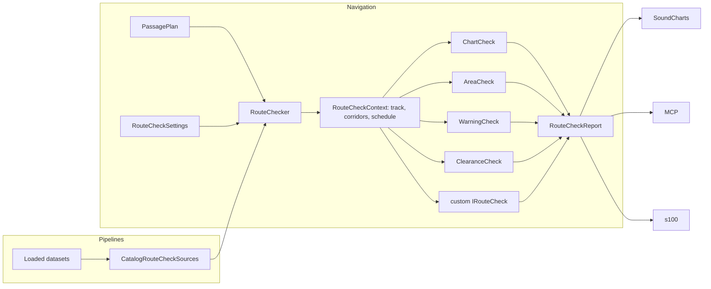

# Route check architecture — Design Note

> Status: **Proposed**. This note reviews the route and passage check engine
> as it stands after the incremental work on clearance, chart, area and
> S-124 checks, and proposes the API it should have before it's documented
> for outside use. The library is in preview, and its only clients are
> SoundCharts, the MCP tools and `s100`, so the proposal reshapes the
> engine's own types rather than adding a facade over them.

## 0. Problem

A route check now combines six products: S-101 (with S-401 and translated
S-57) for land, depths, dangers and regulated areas, S-102 for bathymetry,
S-104 for water level, S-122 for protected areas, S-124 for navigational
warnings and, in SoundCharts only, S-111 for an expired-forecast notice.
Each kind of check was added as its own engine, and each host joined them
up for itself.

The calculations are sound and well tested. What a caller sees is not one
engine but four, plus the joining work they have to redo:

| Engine | Input | Options | Result | Source of data |
|---|---|---|---|---|
| `PassageCheckEngine` | `PassagePlan` of `PassageLeg` | `PassageCheckOptions` | `PassageCheckResult` (no findings) | `IChartedDepthSource`, `IWaterLevelSource` |
| `RouteCheckEngine` | `RouteCheckLeg` list | `RouteCheckOptions` (+ `RouteCheckDepths`, `RouteCheckText`) | `RouteCheckResult` | `IRouteChartSource`, `IChartedDepthSource?` |
| `RouteAreaCheck` | `RouteCheckLeg` list + `RouteWarningTiming` | `RouteAreaOptions` (+ `RouteAreaText`) | `RouteAreaResult` | `IRouteAreaSource`, or lists |
| `RouteWarningCheck` | `RouteCheckLeg` list + `RouteWarningTiming` | `RouteWarningOptions` (+ `RouteWarningText`) | `RouteWarningResult` | lists + `NavigationalWarningSet` |

To get the result that SoundCharts shows, a caller has to do several
things themselves. They resolve one route into two leg types. They compute
a schedule from one leg type to time-check the other. They pick a keel
depth for the dangers check, convert the clearance result into findings,
merge and sort four lists, and derive a verdict. They also build and cache
three source objects per dataset snapshot. No public API does any of this.

## 1. Review

### 1.1 What to keep

- **Navigation depends only on Core.** Data comes in through small
  interfaces, and Pipelines adapts loaded datasets to them. That boundary
  is right and the proposal keeps it.
- **The rules are shared with the pick report.** `ChartedDepthResolver`,
  `WaterLevelPreference`, `VerticalDatumCheck` and `SkinOfTheEarth` give
  the same answer at a point as the check does along a route.
- **The calculations.** The finest-cell rule, exact track crossings,
  corridor cross-sections, the isolated-danger rule, in-force rules judged
  at ETAs, datum checks, and confidence kept separate from state.
- **Incremental UKC.** `SampleDepths` (spatial, slow) is separate from
  `Evaluate` (temporal, cheap), and profiles are reused per leg after an
  edit.
- **Testability.** Every engine runs against fakes, and there are about
  100 unit tests plus scenario tests on real cells.
- **Stable finding codes and ids**, which the MCP and CLI contracts already
  depend on.

### 1.2 Fusion lives in the hosts

The joining logic is written twice, in SoundCharts and in `CheckRouteTool`,
and the copies have drifted:

| Logic | SoundCharts | MCP / `s100` |
|---|---|---|
| Clearance → findings (`clearance.*`, `confidence.*`, `data.*` codes) | `PassageFindings.Build` | not done: `check_route` has no clearance findings, and `get_passage_result` is a separate result |
| Sort | `PassageFindings.Sort` | copied in `CheckRouteTool.Project` |
| Verdict and headline finding | `RouteCheckVerdict.Build`, `MustReviewRank` (matches area codes by substring) | `SummaryText` (an English copy of `NoDraftTitle`); `VerdictTitle` for clearance only |
| Keel for the dangers check | deepest `draft + squat + UKC` over all legs | the same, but with a request draft it takes the maximum squat and the maximum UKC from different legs |
| Time where a leg has no ETA | view time, even when the route has a departure | the departure, else `Time ?? now` |
| Depth checks without safety settings | taken from the mariner settings | skipped silently (MCP); 30 m / 30 m (`s100`) |
| UKC when some legs have no draft | not run | error (MCP); skipped silently (`s100`) |
| Warnings checked | the warnings panel's list and set | every S-124 dataset in the catalog |
| Datasets used | bounding-box overlap | cells near the corridor plus the datasets behind findings |
| Expired S-111 forecast | `data.s111_forecast_expired` | not done |

Route models are converted three more times: `RouteEtas.ToPassageLegs`,
`PassageCheckService.CheckInput.For` and `ViewerPassageRouteProvider`. The
geodesy for "position and ETA at a distance" is in UI classes
(`PassageCheckService.CursorAt`, `RouteCheckOverlay.PathAlong`).

`s100 route check` runs the checks by constructing `CheckRouteTool` and
`GetPassageResultTool`. So it inherits MCP's choices, and its route model
(`PassageRouteSnapshot`) is defined in an MCP tool file.

### 1.3 The engine's own seams are inconsistent

- **Two leg types for one route.** `PassageLeg` has the vessel values,
  `RouteCheckLeg` has the cross-track limits, and both have points and
  geometry. Every host builds both from the same route. `PassageLeg` uses
  draft 0 to mean "no draft".
- **One "depths" concept split across levels.** The vessel values
  (draft, squat, required UKC) are per leg in `PassageLeg`, but the chart
  check takes one route-wide `RouteCheckDepths`. That forces each host to
  invent a keel rule, and the rules have drifted (§1.2). The engine
  already knows which leg each danger is on, so it can use that leg's
  keel.
- **Time has no owner.** `RouteWarningTiming` is named for warnings but
  also drives areas. The clearance check takes a `PassagePlan` departure.
  The schedule is computed by the caller from `PassageLeg`s and passed in.
- **Sources don't match.**
  - Charts and areas have source interfaces, but warnings are passed as
    lists plus a set.
  - `IRouteChartSource` takes `GeoPosition`/`BoundingBox`, while
    `IChartedDepthSource` and `IWaterLevelSource` take bare
    latitude/longitude doubles.
  - `RouteCheckDataSources.Bathymetry` (S-102 only) and
    `PassageDataSources.Depth` (S-102 with S-101 fallback) are two
    `CatalogChartedDepthSource`s over the same surfaces.
  - SoundCharts builds `PassageDataSources` up to three times and
    `RouteCheckDataSources` twice per dataset snapshot.
  - Each host writes its own snapshot cache keyed by reference equality.
- **No finding category for areas.** Area findings say
  `RouteFindingSource.RouteCheck`. That's why SoundCharts recognises them
  by substring.
- **Codes are scattered.** They're in `RouteCheckCodes`, `RouteAreaCodes`
  and `RouteWarningCodes`, while `PassageFindings.Codes` (clearance,
  confidence, data) is in the Viewer. The group and headline rank of a
  code are spread through engine and host code.
- **Text is baked into findings, through four text records.**
  `RouteCheckText`, `RouteAreaText` and `RouteWarningText` each repeat
  `Separator`, `LegFormat` and `Culture`. The clearance wording isn't in
  the SDK at all. Findings carry only rendered `Title`/`Meta` strings,
  except S-124's typed `Warning`. So a client can't get the depth that
  fired, the threshold or the area's restrictions without parsing text.
- **Options repeat themselves.** `DefaultHalfWidthMeters` is in three
  options records, and segment and station spacing are in three.
- **"Not checked" looks the same as "nothing found".** Skipping the depth
  checks for lack of settings, the clearance check for lack of a draft, or
  the warnings check for lack of S-124 all produce no findings and no
  record of the skip.
- **Conventions.**
  - Physical values are `double …Meters` and `…Knots`, where the adopted
    quantity types (`Length`, `Depth`, `Speed`; see
    [Quantity types](quantity-types.md)) are the contract. `MarinerSettings`
    already uses `Depth`.
  - Results and findings are `record`s with collection fields, which
    [API conventions §2](api-conventions.md)
    says should be classes.
  - The Navigation README says every check produces `RouteFinding`s; the
    clearance engine doesn't.
- **Thread safety is undocumented.** `GetPassageResultTool` serialises
  whole runs because the sources share S-101 indexes and transforms. The
  contract for concurrent use isn't written down anywhere.

## 2. Proposed design

There is one route model and one settings object. One set of sources is
built per dataset snapshot. One checker runs a list of checks and returns
one report: findings, verdict, what ran, and the per-check detail. The
existing engines become checks behind that seam, and the hosts become
projection and presentation code.



### 2.1 One route model

`PassagePlan` and `PassageLeg` become the only route input. They carry
everything any check reads, with quantity types and honest nulls.

```csharp
public sealed class PassagePlan
{
    public PassagePlan(IReadOnlyList<PassageLeg> legs, DateTimeOffset? departure = null);
    public IReadOnlyList<PassageLeg> Legs { get; }
    public DateTimeOffset? Departure { get; }      // null: no ETAs
}

public sealed class PassageLeg
{
    public required IReadOnlyList<GeoPosition> Points { get; init; }
    public LegGeometry Geometry { get; init; } = LegGeometry.Rhumb;
    public Length? PortLimit { get; init; }        // XTD half-widths; null → options default
    public Length? StarboardLimit { get; init; }
    public Speed? Speed { get; init; }             // SOG; null → this and later legs have no ETA
    public Depth? Draft { get; init; }             // null: no draft (not 0)
    public Depth Squat { get; init; }
    public Depth? RequiredUkc { get; init; }
    public string? Name { get; init; }
}
```

This removes `RouteCheckLeg`, MCP's `PassageRouteSnapshot` and
`PassageRouteLeg`, and SoundCharts' `CheckInput`. Each host keeps exactly
one conversion from its own route type. RTZ and S-421 conversions move
next to their readers (see §4, open question 3).

### 2.2 Settings and options

The proposal separates what the user decides on each run (settings) from
how the engine is tuned once (options).

```csharp
public sealed class RouteCheckSettings
{
    public Depth? SafetyContour { get; init; }     // null: depth checks skipped, and reported as skipped
    public Depth? SafetyDepth { get; init; }
    public Length? CorridorOverride { get; init; } // replaces every leg's limits
    public required DateTimeOffset At { get; init; } // judges areas/warnings where there's no ETA
    public DepartureRange? DepartureWindow { get; init; } // optional sweep

    public static RouteCheckSettings FromMarinerSettings(MarinerSettings settings, DateTimeOffset at);
}

public sealed class RouteCheckOptions
{
    public static RouteCheckOptions Default { get; }
    public Length DefaultLimit { get; init; }      // one 50 m default
    public ChartCheckOptions Chart { get; init; }  // station spacing, danger-near distance, merge gaps
    public WarningCheckOptions Warnings { get; init; }
    public ClearanceCheckOptions Clearance { get; init; } // today's PassageCheckOptions
    public RouteFindingFormatter Formatter { get; init; } // §2.5
}
```

It also fixes the rules that drifted between hosts:

- **Time.** An ETA is used where one exists. Without one, the plan's
  departure is used, and without that, `settings.At`. This matches what
  [Route checks](../route-checks.md) already says.
- **Keel.** Each danger is judged against the keel of the leg it's
  reported on: `Draft + Squat + RequiredUkc` from that leg. The route-wide
  `RouteCheckDepths` and both hosts' keel rules go.
- **Gating.** A check that can't run is reported as skipped, with a
  reason (§2.4), never silently. The clearance check runs on legs that
  have a draft. A plan with drafts on only some legs is skipped with
  reason `draft_missing`, so the hosts don't need to make it an error.

### 2.3 One set of sources

```csharp
public sealed class RouteCheckSources
{
    public IRouteChartSource? Charts { get; init; }
    public IChartedDepthSource? Depth { get; init; }        // S-102 with S-101 fallback; ChartedDepth.Kind tells which
    public IWaterLevelSource? WaterLevel { get; init; }
    public IRouteAreaSource? Areas { get; init; }
    public IRouteWarningSource? Warnings { get; init; }     // new
}

public interface IRouteWarningSource
{
    IReadOnlyList<RouteWarning> WarningsNear(BoundingBox extent);
    NavigationalWarningSet Set { get; }                     // cancellations and bulletins
}
```

- **One depth source.** The chart check's S-102 shoal test filters to
  `ChartedDepthKind.Bathymetry`, and the clearance check uses the whole
  fallback chain. One S-102 index serves both.
- **Consistent geometry types.** Every source interface takes
  `GeoPosition` and `BoundingBox`.
- **Pipelines builds the bundle.** `CatalogRouteCheckSources.FromDatasets(datasets, transforms, options)`
  returns a bundle, and `RouteCheckSourceCache` holds the
  snapshot-keyed cache that all three hosts write today.
- **SoundCharts can swap one source.** It passes its own
  `IRouteWarningSource` over the warnings panel, so the checker judges the
  same warnings the panel shows.
- **Thread safety becomes a contract.** Sources must be safe for
  concurrent reads. The Pipelines implementations make their lazy indexes
  thread-safe, and the MCP semaphore goes.

### 2.4 Checker, checks and report

```csharp
public sealed class RouteChecker
{
    public RouteChecker(RouteCheckSources sources, RouteCheckOptions? options = null,
                        IEnumerable<IRouteCheck>? additionalChecks = null);

    // Synchronous, CPU-bound; the token allows cooperative cancellation.
    public RouteCheckReport Check(PassagePlan plan, RouteCheckSettings settings,
                                  CancellationToken cancellationToken = default);
}

public interface IRouteCheck
{
    string Name { get; }                                   // "chart", "areas", "warnings", "clearance", …
    RouteCheckOutcome Run(RouteCheckContext context, CancellationToken cancellationToken);
}

public sealed class RouteCheckContext
{
    public PassagePlan Plan { get; }
    public RouteCheckSettings Settings { get; }
    public RouteCheckSources Sources { get; }
    public RouteTrack Track { get; }                       // densified track, corridors, distance ↔ position
    public PassageSchedule Schedule { get; }               // ETAs, with the time rule in §2.2
    public RouteCheckOptions Options { get; }
}

public sealed class RouteCheckOutcome
{
    public static RouteCheckOutcome Skipped(string reason);
    public static RouteCheckOutcome Ran(IReadOnlyList<RouteFinding> findings, object? detail = null);
}

public sealed class RouteCheckReport
{
    public PassagePlan Plan { get; }
    public PassageSchedule Schedule { get; }
    public RouteTrack Track { get; }
    public IReadOnlyList<RouteFinding> Findings { get; }   // sorted: group, distance, then stable
    public RouteFindingCounts Counts { get; }
    public RouteCheckVerdict Verdict { get; }
    public IReadOnlyList<RouteCheckStatus> Checks { get; } // name, ran/skipped, reason
    public ClearanceResult? Clearance { get; }             // today's PassageCheckResult
    public IReadOnlyList<RouteAreaMatch> Areas { get; }
    public IReadOnlyList<RouteWarningMatch> Warnings { get; }
    public IReadOnlyList<string> DatasetsUsed { get; }     // recorded by the sources, not guessed
}

public sealed class RouteCheckVerdict
{
    public RouteCheckVerdictKind Kind { get; }  // MustReview, WaterLevelEndsBeforeArrival, Check, Clear
    public RouteFinding? Headline { get; }      // the finding that names it, by code rank
}
```

The existing engines become the built-in checks:

- `ChartCheck` is today's `RouteCheckEngine`. It keeps one sweep for land,
  drying ground, coverage, the safety contour, soundings, S-102 shoals and
  dangers, because those all read the same corridor features.
- `AreaCheck` is today's `RouteAreaCheck`.
- `WarningCheck` is today's `RouteWarningCheck`.
- `ClearanceCheck` wraps today's `PassageCheckEngine`. It also turns its
  result into findings: below setting, confidence and gaps, which moves
  `PassageFindings.Build` out of SoundCharts.
- An optional `DataCurrencyCheck` covers out-of-date forecast data (see
  §4, open question 4).

Four pieces of work stop being done once per check:

- `RouteTrack` is built once per run and shared. Today the chart, area
  and warning checks each densify the route at their own spacing.
- `RouteTrack` also exposes `PositionAt(distance)` and `PathBetween(a, b)`,
  which replace the geodesy in SoundCharts' `CursorAt` and `PathAlong`.
- **Incremental work moves into the checker.** It keeps the last depth
  profile per leg geometry and the last chart findings per geometry and
  settings. Moving a waypoint resamples only the changed legs. Changing
  the departure only re-evaluates the clearance and re-judges times.
  Hosts stop holding `PassageDepthProfile`.
- **Departure sweeps** become `settings.DepartureWindow` on the same call.
  The result is `ClearanceResult.Departures`. `SweepWaterLevelRange`
  becomes a `DepartureRange.WaterLevelData` value.

The per-check types (`ChartCheck`, `AreaCheck` and the others) stay public
and can be run on their own. The checker is how you run all of them, not
the only way.

### 2.5 Findings: structured first, text second

```csharp
public sealed class RouteFinding
{
    public string Id { get; }                      // unchanged scheme
    public RouteFindingCode Code { get; }
    public RouteFindingGroup Group { get; }
    public RouteFindingCategory Category { get; }  // Chart, Depth, Area, Warning, Clearance, Confidence, Data
    public int? LegIndex { get; }
    public Length? Distance { get; }
    public RouteFindingLocation? Location { get; }
    public RouteFindingFeature? Feature { get; }
    public RouteFindingDetails? Details { get; }   // typed, per kind
    public string Title { get; }                   // rendered by the formatter
    public string Meta { get; }
}

public abstract class RouteFindingDetails;
public sealed class DangerDetails : RouteFindingDetails { /* feature type, depth or water-level effect, threshold that fired, side, offset */ }
public sealed class ShoalDetails : RouteFindingDetails { /* least depth, threshold, count, S-102 uncertainty */ }
public sealed class AreaDetails : RouteFindingDetails { /* product, kind, restrictions, categories, in-force, from/until */ }
public sealed class WarningDetails : RouteFindingDetails { /* today's RouteFindingWarning */ }
public sealed class ClearanceDetails : RouteFindingDetails { /* minimum, margin, minutes below, state */ }
```

- **One code catalogue.** `RouteFindingCodes` holds every code as a
  `RouteFindingCode` (value, category, default group, headline rank). This
  replaces the four code classes and the Viewer's `MustReviewRank`. The
  verdict uses the rank, and the MCP schema and the docs table can be
  generated from the catalogue.
- **One formatter.** `RouteFindingFormatter` renders `Title` and `Meta`
  from the details and replaces the four text records. Its virtual members
  default to invariant English, and it takes one culture, depth unit and
  time format. SoundCharts subclasses it over `Strings.resx`. MCP and
  `s100` use the default, and MCP adds `details` to its JSON so clients get
  numbers instead of parsing text.
- `RouteFindingSource` becomes `RouteFindingCategory`, with `Area` and
  `Depth` split out, so nothing has to match codes by substring.

### 2.6 Package boundaries and hosts

| Package | Owns |
|---|---|
| `EncDotNet.S100.Navigation` | the plan, settings, options, sources interfaces, checker, checks, report, codes and formatter. Still Core-only. |
| `EncDotNet.S100.Datasets.Pipelines` | `CatalogRouteCheckSources`, `RouteCheckSourceCache`, and (pending open question 3) conversions from S-421 and RTZ to `PassagePlan`. |
| `EncDotNet.S100.Mcp.Tools` | projecting `RouteCheckReport` to DTOs. `check_route` returns the whole report, clearance included. `get_passage_result` keeps the detail (samples, window). |
| `s100 route check` | reads the file, builds the plan, calls `RouteChecker`, and maps `Verdict.Kind` to the exit code. It stops constructing MCP tools. The CLI still references the MCP packages for `s100 mcp`. |
| SoundCharts | its route → `PassagePlan` conversion, the view time as `At`, a panel-backed `IRouteWarningSource`, a resx formatter, the verdict card, legend and follow. The producers, `PassageFindings` and `RouteCheckVerdict.Build` collapse into presentation code. |

## 3. Migration

Each step is one PR that leaves all three hosts building and their tests
passing. Codes and ids don't change at any step, so the scenario, MCP and
CLI tests act as the regression net.

1. **Route model and quantity types.**
   - Introduce the new `PassagePlan` and `PassageLeg`, and
     `RouteCheckSettings`.
   - Make all four engines take them, and judge dangers by per-leg keel.
   - Replace `RouteWarningTiming` with the schedule and the time rule.
   - Delete `RouteCheckLeg`, `RouteCheckDepths` and both hosts' keel rules.
2. **Sources.**
   - Add `RouteCheckSources`, `IRouteWarningSource`, the single depth
     source and `GeoPosition`-based interfaces.
   - Add `CatalogRouteCheckSources` and `RouteCheckSourceCache`.
   - Make the sources thread-safe and drop the MCP semaphore.
3. **Findings.**
   - Add the code catalogue, categories, details and formatter.
   - Move clearance-to-findings into `ClearanceCheck`.
   - Delete the three text records and `PassageFindings`.
4. **Checker and report.**
   - Add `RouteChecker`, `IRouteCheck`, `RouteTrack`, `RouteCheckReport`,
     the verdict, per-check status and checker-owned incremental caching.
5. **Hosts.**
   - Rewrite `check_route`, `get_passage_result` and `s100 route check`
     over the checker.
   - Collapse SoundCharts' producers.
   - Add a parity test that runs one scenario through the SDK, MCP and
     `s100` and compares their findings.
6. **Lock down.**
   - Add a public API baseline for Navigation.
   - Write the "How a route check works" article and a runnable sample.

Steps 1 and 3 are the largest. Step 4 only makes sense after 1–3.

## 4. Open questions

1. **Quantity types in the public API.** This note proposes `Length`,
   `Depth` and `Speed` throughout, since the API is breaking anyway.
   Internals stay in metres as doubles.
2. **Rendered text on findings.** This note keeps `Title`/`Meta` on the
   finding, rendered by the configured formatter, so a host can show a
   report without another call. The alternative is details only, with
   hosts calling the formatter. That's purer, but every host would need
   the same call.
3. **Where RTZ and S-421 → `PassagePlan` conversion lives.** Pipelines
   references S-421 but not `Routes.Rtz`. The options are a small
   `Navigation.Routes` adapter package, or Pipelines taking a reference to
   `Routes.Rtz`.
4. **Data currency.** SoundCharts flags an expired S-111 forecast, but no
   check reads S-111. Either generalise it into a `DataCurrencyCheck` for
   every product that contributed (S-104 included), or drop it.
5. **Merging `check_route` and `get_passage_result` in MCP.** With one
   report, `check_route` could carry the clearance summary, leaving
   `get_passage_result` for samples and the window. Or the two could become
   one tool with detail flags.
6. **Name of the umbrella.** "Route check" (the codes, the docs, `s100
   route check`) versus "passage check" (`PassageCheckEngine`, the
   SoundCharts services). This note uses route check for the whole and
   clearance check for UKC.
