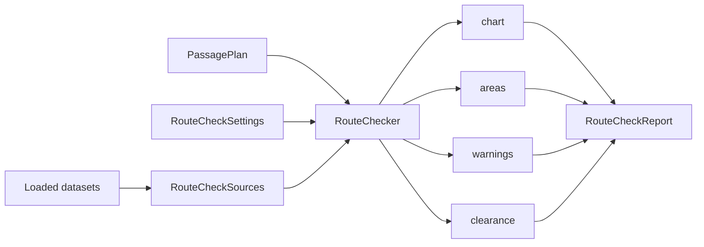

# How a route check works

A route check runs on one `PassagePlan` and returns one `RouteCheckReport`.
`RouteChecker` in the `EncDotNet.S100.Navigation` package runs four checks
(chart, areas, warnings and clearance) over one `RouteCheckSources` bundle,
which `CatalogRouteCheckSources` in `EncDotNet.S100.Datasets.Pipelines`
builds from loaded datasets. SoundCharts, the MCP `check_route` tool and
`s100 route check` all call the same checker.

This page explains which data each check reads, which time and keel it
judges at, and how the report's verdict and check status are formed. For
what each finding means to a navigator and the thresholds behind it, see
[Route checks and under-keel clearance](route-checks.md). The results are an
aid for exploring the data, not for navigation.



## Run a check

The [route check sample](../samples/EncDotNet.S100.Samples.RouteCheck/README.md)
runs these steps on synthetic data. Install the packages:

```bash
dotnet add package EncDotNet.S100.Navigation
dotnet add package EncDotNet.S100.Datasets.Pipelines
dotnet add package EncDotNet.S100.Crs.ProjNet
```

Then load the datasets, build the sources and the checker once, and check a
plan:

```csharp
using EncDotNet.S100.Crs.ProjNet;
using EncDotNet.S100.DataModel;
using EncDotNet.S100.Datasets.Pipelines;
using EncDotNet.S100.Datasets.Pipelines.Catalog;
using EncDotNet.S100.Datasets.Pipelines.Navigation;
using EncDotNet.S100.Navigation;
using EncDotNet.S100.Quantities;

var transforms = new ProjNetCrsTransformFactory();
var inputs = Directory.EnumerateFiles("path/to/data", "*", SearchOption.AllDirectories)
    .Select(path => (Path: path, Spec: DatasetPipelineFactory.DetectProductSpec(path)))
    .Where(file => file.Spec is not null)
    .Select(file => new FileDatasetInput(new DatasetId(file.Path), file.Spec!, file.Path));
var catalog = FileDatasetCatalog.Build(inputs, transforms);

var sources = CatalogRouteCheckSources.FromDatasets(catalog.Datasets, transforms);
var checker = new RouteChecker(sources);

PassageLeg Leg(GeoPosition from, GeoPosition to) => new()
{
    Points = [from, to],
    PortLimit = Length.FromMetres(100),
    StarboardLimit = Length.FromMetres(100),
    Speed = Speed.FromKnots(8),
    Draft = Depth.FromMetres(7.0),
    Squat = Depth.FromMetres(0.4),
    RequiredUkc = Depth.FromMetres(1.0),
};

var a = new GeoPosition(-40.97036, -134.99405);
var b = new GeoPosition(-40.97036, -134.96429);
var c = new GeoPosition(-40.97260, -134.93215);
var plan = new PassagePlan([Leg(a, b), Leg(b, c)], new DateTimeOffset(2026, 3, 1, 6, 0, 0, TimeSpan.Zero));

var report = checker.Check(plan, new RouteCheckSettings
{
    SafetyContour = Depth.FromMetres(10),
    SafetyDepth = Depth.FromMetres(10),
    At = DateTimeOffset.UtcNow,
});

Console.WriteLine($"{report.Verdict.Kind}: {report.Verdict.Headline?.Title}");
foreach (var finding in report.Findings)
{
    Console.WriteLine($"{finding.Group} {finding.Code} leg {finding.LegIndex + 1}: {finding.Title}");
}
```

To check an RTZ or S-421 route file instead, convert it to a plan in its own
package: `RtzReader.Read(path).ToPassagePlan()` in `EncDotNet.S100.Routes.Rtz`,
or `S421RoutePlan.From(dataset, out _).Route.ToPassagePlan()` in
`EncDotNet.S100.Datasets.S421`.

Keep the checker while the same datasets are loaded. Each check keeps what
its last run computed: the chart check reuses its result while the legs and
depth settings are unchanged, and the clearance check resamples depths only
on legs whose points changed. `Check` may be called from several threads at
once.

## Where each dataset is used

`CatalogRouteCheckSources` sorts the loaded datasets into the five members of
`RouteCheckSources`. Each check reads only the members it needs:

| Product | Source | Check | Used for |
|---|---|---|---|
| S-101 cells, S-401 cells and S-57 cells translated to S-101 | `Charts` | chart | Land, coastline, drying ground, `DataCoverage`; with safety settings, depth and dredged areas, soundings, wrecks, obstructions and rocks |
| The same cells | `Areas` | areas | Restricted, military practice, caution, anchorage and traffic areas |
| The same cells | `Depth` | clearance | Charted depth where no S-102 covers the route: dredged area, then depth area, then a sounding within 250 m |
| S-102 bathymetry | `Depth` | chart, clearance | The chart check's S-102 shoal test; the clearance check's charted depth, first choice |
| S-104 water levels (grids and stations) | `WaterLevel` | clearance | The water level at each sample's ETA |
| S-122 marine protected areas | `Areas` | areas | Marine protected and restricted areas |
| S-124 navigational warnings | `Warnings` | warnings | Warning parts near the route, and the set of all warnings for cancellations and in-force bulletins |

Other products, including S-111 surface currents, S-127 and S-131, aren't
read. Speeds are speeds over ground, and currents aren't applied to ETAs.

Where S-101 cells overlap, only the finest cell at a place counts, so a
coarse cell's generalised land or areas don't fire where a finer cell charts
water.

`CatalogRouteCheckSources` always fills every member, even when no dataset
of that product is loaded. So with the catalog bundle a missing product
doesn't skip a check. It shows up as coverage findings instead, such as
`data.outside_chart_coverage` or `data.no_water_level_coverage`. To leave a
check's data out, build `RouteCheckSources` yourself and leave that member
`null`; the check is then skipped, as described in
[Check status](#check-status).

## Time

Areas, warnings and water levels change over time. Every check judges them
by one rule:

1. The ETA at that point of the route, where the leg has one.
2. Otherwise, the plan's `Departure`.
3. Otherwise, `RouteCheckSettings.At`.

ETAs come from the plan's departure and each leg's `Speed`
(`PassageSchedule`). A leg without a speed has no ETAs, and nor do the legs
after it. The chart check doesn't use time.

- **Areas** are judged at the ETAs over the stretch where the route is in
  the area, against the area's date range and seasons.
- **Warnings** are judged at the ETA where the route meets the warning,
  against its validity, cancellation date, cancelling warnings and the latest
  in-force bulletin.
- **Water levels** are read from S-104 at each sample's ETA, interpolated
  between time steps.

Each host picks `At` for itself. SoundCharts uses the view time. MCP
`check_route` uses the departure (the `departure` argument, else the
route's) and, without one, now. `s100 route check` always has a departure:
`--departure`, else the file's, else now.

## Keel

The vessel's values are per leg. A leg's keel is its
`Draft + Squat + RequiredUkc`.

- **Dangers.** A wreck, obstruction or rock on a leg is judged against the
  safety depth and, when that leg has a draft, also against that leg's keel,
  on the static charted depth. A leg without a draft is judged against the
  safety depth only.
- **Clearance.** The clearance check runs only when every leg has a draft.
  It computes UKC = charted depth + water level − draft − squat at each
  sample and compares it with that leg's required UKC, or 0 m when none is
  set.

`RouteCheckSettings.CorridorOverride` replaces every leg's `PortLimit` and
`StarboardLimit`. A side without a limit uses `RouteCheckOptions.DefaultLimit`
(50 m).

## Verdict

`report.Verdict.Kind` is the first of these that applies:

| Kind | When |
|---|---|
| `MustReview` | Any finding is Must review, or the clearance is below your UKC setting. |
| `WaterLevelEndsBeforeArrival` | The S-104 data ends before the vessel arrives. |
| `Check` | Any finding is Check, or the clearance is tight or has incomplete data. |
| `Clear` | Nothing else applies. |

`report.Verdict.Headline` is the finding that names the verdict. For
`MustReview` it's the Must review finding with the lowest
`RouteFindingCode.HeadlineRank`: crosses land, crosses drying ground, a
regulated area, a danger in the corridor, below your UKC setting, a warning
in force on the route, then anything else. For `Check` it's the first Check
finding. `report.Counts` gives the number of findings in each group.

## Check status

`report.Checks` lists every check that was run, in order, with its `State`,
a `Reason` and its number of findings. A check that can't do its work says
so rather than reporting nothing:

| Check | Skipped when | Partial when |
|---|---|---|
| `chart` | `Charts` is null (`charts_missing`) | No safety contour or safety depth (`safety_settings_missing`): only land, drying ground and coverage are checked |
| `areas` | `Areas` is null (`areas_missing`) | |
| `warnings` | `Warnings` is null (`warnings_missing`) | |
| `clearance` | `Depth` is null (`depth_missing`), `WaterLevel` is null (`water_level_missing`), or a leg has no draft (`draft_missing`) | |

The reasons are constants in `RouteCheckReasons`. `report.Status("clearance")`
returns one check's status. A skipped check's detail is `null`:
`report.Clearance` is `null` when the clearance check didn't run.

## Finding codes

Every finding's `Code` is one of the codes in `RouteFindingCodes`. Codes
don't change, because MCP clients and CI runs of `s100 route check` depend
on them. The group is each code's default; some checks move a finding one
group lighter, such as an area that only reaches inside the cross-track
limits.

| Code | Check | Category | Group | When |
|---|---|---|---|---|
| `route_check.crosses_land` | chart | Chart | MustReview | The track crosses land or a coastline. |
| `route_check.land_in_corridor` | chart | Chart | Check | Land reaches inside the cross-track limits. |
| `route_check.crosses_drying` | chart | Chart | MustReview | The track crosses drying ground. |
| `route_check.drying_in_corridor` | chart | Chart | Check | Drying ground reaches inside the limits. |
| `route_check.danger_in_corridor` | chart | Depth | MustReview | A danger shallower than the threshold, or of unknown depth, inside the limits. |
| `route_check.danger_near_route` | chart | Depth | Check | Such a danger within 0.1 NM beyond the limits. |
| `route_check.crosses_safety_contour` | chart | Depth | MustReview | The track crosses areas shallower than the safety contour. |
| `route_check.safety_contour_in_corridor` | chart | Depth | Check | Such areas inside the limits. |
| `route_check.soundings_below_safety_depth` | chart | Depth | Check | Soundings shallower than the safety depth inside the limits. |
| `route_check.crosses_s102_shoal` | chart | Depth | MustReview | The track crosses S-102 cells shallower than the safety contour. |
| `route_check.s102_shoal_in_corridor` | chart | Depth | Check | Such S-102 cells inside the limits. |
| `route_check.enters_prohibited_area` | areas | Area | MustReview | The track enters an S-101 area where entry is prohibited or restricted. |
| `route_check.prohibited_area_in_corridor` | areas | Area | Check | Such an area inside the limits. |
| `route_check.restricted_area` | areas | Area | Check | Another S-101 restricted or military practice area. |
| `route_check.caution_area` | areas | Area | Check | An S-101 caution area. |
| `route_check.traffic_area` | areas | Area | Check | An S-101 separation zone, precautionary area, submarine transit lane or inshore traffic zone. |
| `route_check.anchorage_area` | areas | Area | Check | An S-101 anchorage area. |
| `route_check.protected_area` | areas | Area | Check | An S-122 marine protected or restricted area. |
| `route_check.area_not_in_force` | areas | Area | Info | An area that isn't in force while the vessel is there. |
| `s124.on_route` | warnings | Warning | MustReview | A warning crosses the corridor and is in force. |
| `s124.near_route` | warnings | Warning | Check | A warning is near the route and in force. |
| `s124.not_in_force` | warnings | Warning | Info | A warning on or near the route isn't in force then. |
| `s124.cancelled` | warnings | Warning | Info | A warning on or near the route is cancelled by then. |
| `clearance.below_setting` | clearance | Clearance | MustReview | A stretch where UKC is below the required UKC. |
| `confidence.charted_depth_from_s101` | clearance | Confidence | Check | A stretch where the charted depth is from S-101. |
| `confidence.datum_unconfirmed` | clearance | Confidence | Check | A stretch where a vertical datum isn't declared. |
| `data.outside_chart_coverage` | chart | Data | Check | The track leaves the coverage of every loaded chart. |
| `data.water_level_ends` | clearance | Data | Check | The water-level data ends before the vessel gets there. |
| `data.water_level_starts_late` | clearance | Data | Check | The water-level data starts after the vessel has passed. |
| `data.no_water_level_coverage` | clearance | Data | Check | A stretch outside every water-level dataset. |
| `data.water_level_no_data` | clearance | Data | Check | A stretch where the water-level data has no value. |
| `data.datum_mismatch` | clearance | Data | Check | The water level's datum differs from the charted depth's, so it isn't applied. |
| `data.no_charted_depth` | clearance | Data | Check | A stretch with no charted depth from S-102 or S-101. |

Each finding also has its leg, its distance from departure, a location, the
feature behind it when there is one, typed `Details` and a `Title` and `Meta`
line rendered by `RouteFindingFormatter`. See the
[Navigation package README](../src/EncDotNet.S100.Navigation/README.md#findings).

## One checker, three hosts

Each host converts its own route to a `PassagePlan`, fills
`RouteCheckSettings`, calls `RouteChecker.Check` and presents the report:

| Host | Plan from | Settings from | Presents |
|---|---|---|---|
| Your code | A `PassagePlan` you build, or an RTZ or S-421 file converted in its package | `RouteCheckSettings`, or `RouteCheckSettings.FromMarinerSettings` | `RouteCheckReport` |
| SoundCharts | The selected route in the **Routes** panel | **Mariner Settings**; `At` is the view time | The verdict card, findings list and **Clearance** tab |
| MCP `check_route` | A SoundCharts route, or a polyline | The tool's arguments | The report as JSON. See [Check a route](mcp-server.md#check-a-route). |
| `s100 route check` | An RTZ or S-421 file | Command-line options | Text or JSON, and exit code `7` by verdict. See [route check](cli.md#route-check). |

Because every host runs the same checks on the same sources, a route checked
against the same datasets with the same settings gets the same verdict and
the same finding codes and ids in each.
